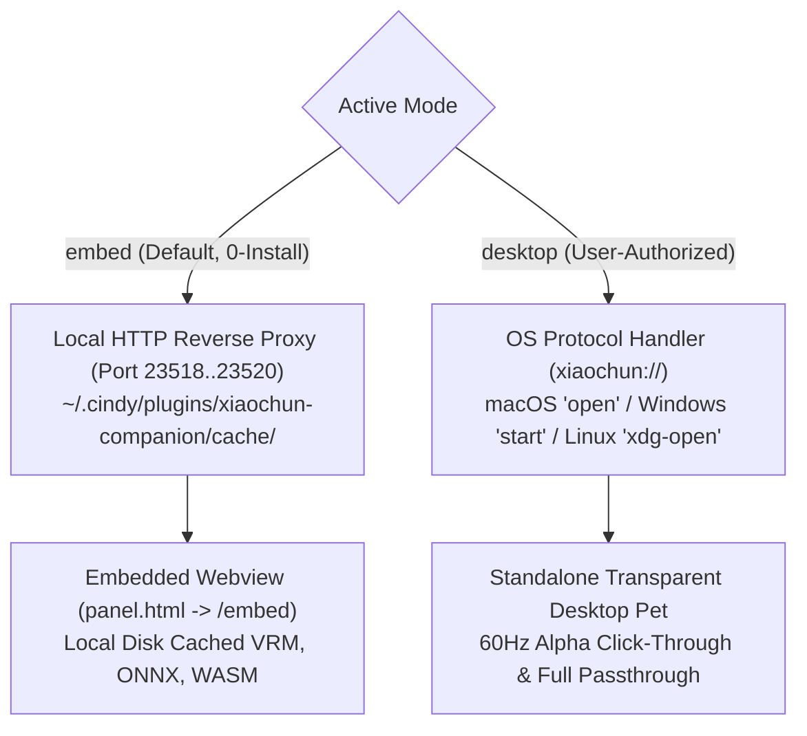
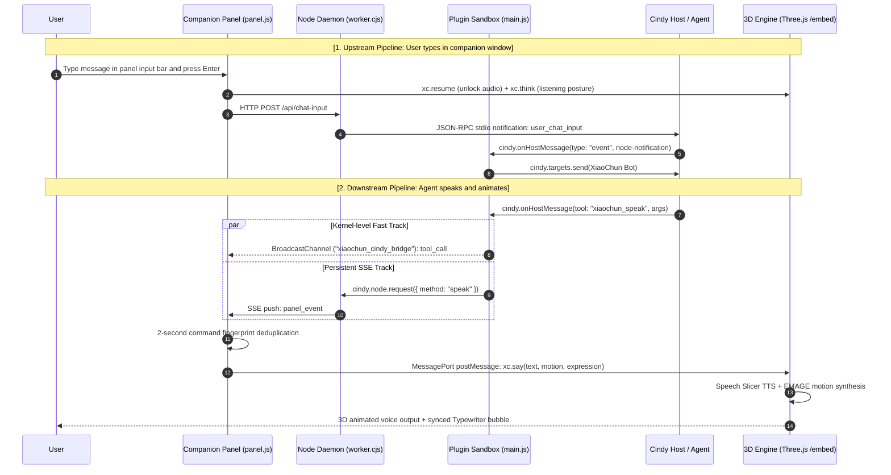
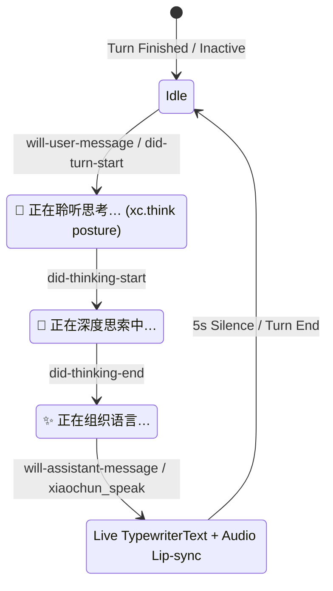

# Cindy Ghost Plugin Architecture & Runtime Reference (CINDY_PLUGIN.md)

> **Document Scope**: Complete engineering specifications, runtime lifecycles, cross-process IPC pipelines, security review boundaries, and streaming projection protocols for the official Cindy Plugin (`packages/cindy-plugin/`). **Read this before modifying plugin manifest, bridging daemons, or companion communication code.**

---

## 1. Overview & Architectural Role

The Cindy Plugin (`xiaochun-companion`) is an integrated 3D AI companion module authored under the **Cindy Ghost Plugin Schema v3** specification. It empowers the Cindy Desktop Agent ecosystem with a persistent, embodiment-aware 3D avatar supporting natural speech, EMAGE-driven physical gestures, and dual-mode runtime options.

```
packages/cindy-plugin/
├── ghost.json            # Plugin manifest (Schema v3, resident lifecycle, sidebar mainView, hooks, tools)
├── main.js               # Sandboxed host extension entry (tool dispatch, bot routing, lifecycle hooks)
├── panel.html / panel.js # Primary viewport (mainView): embedded 3D companion canvas, chat input bar, IPC
├── settings.html / .js   # Native configuration panel (mode switcher: embed vs desktop, diagnostics)
├── node/worker.cjs       # Resident Node.js daemon (HTTP/SSE bridge, reverse proxy, disk cache, deep-link)
├── test-plugin.mjs       # Automated pre-flight validation suite (Schema v3, i18n, RPC conformance)
├── locales/              # 4-language i18n packs (zh-CN, en, ja, ko)
└── manual/xiaochun/      # Bundled user manuals and Agent skill specifications
```

---

## 2. Cindy Schema v3 Manifest Specifications

The plugin configuration in [`packages/cindy-plugin/ghost.json`](file:///Users/FireTable/OpenClaw/Code/Project-XiaoChun/packages/cindy-plugin/ghost.json) strictly satisfies Cindy's latest `schemaVersion: 3` standard:

| Manifest Field | Configured Value | Architectural Role & Runtime Guarantees |
| :--- | :--- | :--- |
| **`launch`** | `"resident"` | Keeps the plugin sandboxed script (`main.js`) resident in Cindy's main process memory. Prevents state loss across chat sessions and enables persistent event listeners. |
| **`mainView`** | `{ "open": "sidebar", "side": "right", "html": "panel.html" }` | Declares the primary split-screen view on the right-hand sidebar. Guarantees side-by-side companionship without masking the main Cindy conversation stream. |
| **`node`** | `{ "entry": "node/worker.cjs", "lifecycle": "resident", "protocol": "json-rpc-stdio" }` | Spawns a dedicated Node.js background worker communicating via standard I/O JSON-RPC 2.0. Avoids process spawn latency for filesystem, caching, and OS calls. |
| **`agent`** | `{ "tasks": true, "targets": true }` | Grants access to `cindy.targets.list` and `cindy.targets.send`, allowing user messages typed inside the companion panel to route into active Cindy Agent chat sessions. |
| **`subscribe`** | `topics: ["turn", "activity"]`, `hooks: ["will-user-message", "will-assistant-message"]` | Subscribes to turn boundaries (`did-turn-start`, `did-turn-end`), model reasoning stages (`did-thinking-start`, `did-thinking-end`), and full-text interceptors. |
| **`preview`** | `{ "hosts": ["127.0.0.1", "localhost"] }` | Whitelists local loopback addresses so the embedded Webview can communicate with the Node daemon HTTP/SSE endpoints without webRequest blocks. |
| **`CSP`** | Strict External Scripts | `panel.html` and `settings.html` contain zero inline `<script>` tags, strictly sourcing external `.js` files to comply with Electron's Content Security Policy. |

---

## 3. Dual Execution Modes: Embed vs. Desktop

The plugin orchestrates two mutually exclusive runtime paradigms through [`node/worker.cjs`](file:///Users/FireTable/OpenClaw/Code/Project-XiaoChun/packages/cindy-plugin/node/worker.cjs):



### 3.1 Embed Mode (`mode: "embed"`)
- **Default Baseline**: Zero installation, zero external dependencies. Runs directly inside the Cindy sidebar webview via `panel.html`.
- **Local Reverse Proxy & Disk Caching**:
  - The Node daemon binds to loopback ports (`23518`, `23519`, `23520` with self-healing failover).
  - Proxy requests to `xiaochun.firetable.tech` enforce `accept-encoding: identity`, storing raw, uncorrupted binary streams (`.vrm`, `.onnx`, `.wasm`, `.mp3`) into `~/.cindy/plugins/xiaochun-companion/cache/`.
  - Serves HTML with `no-cache, no-store, must-revalidate` to guarantee immediate frontend hot updates while serving heavy 3D assets in **0ms from local NVMe/SSD storage** (supporting 100% offline usage).
  - Dynamically patches Electron `origin: "null"` defects for `cindy-ghost:` protocols to preserve iframe postMessage handshakes.

### 3.2 Desktop Mode (`mode: "desktop"`)
- **User Permission Guardrail**: Never silently downloads the desktop client. If not installed, it returns `needSetupChoice: true` requesting explicit user approval.
- **Deep-Link Protocol Handshake**:
  - Commands dispatch via OS URI scheme `xiaochun://<action>?<params>`.
  - For long speech texts (>400 characters), automatically switches to temporary file descriptors (`xiaochun_speech_*.txt`) to prevent OS command-line buffer overflows.
  - Automatically handles process cold-starts via macOS `open -a Project-XiaoChun`.

---

## 4. End-to-End Bidirectional Pipeline

The complete communication graph bridges the human user, the Cindy Host Agent, the sandboxed plugin (`main.js`), the local daemon (`worker.cjs`), the sidebar UI (`panel.js`), and the Three.js 3D engine:



### 4.1 Command Deduplication
Because downlinks are emitted over both `BroadcastChannel` (fast-path, <1ms) and `worker.cjs` SSE (fallback, ~10ms), [`panel.js`](file:///Users/FireTable/OpenClaw/Code/Project-XiaoChun/packages/cindy-plugin/panel.js) maintains a LRU fingerprint cache (`recentCommands`). Identical method calls with identical argument hashes within a 2000ms window are deduplicated, ensuring zero stutter or re-triggering.

---

## 5. Speech Slicer Streaming & 3D Bubble Projection

Introduced in v1.0.5, these features eliminate interaction latency and synchronize model reasoning state into the 3D world:

### 5.1 Speech Slicer Streaming Queue
- **Problem**: Long replies (300+ characters) synthesized as a single monolithic block suffered from 1.5~2.5s Edge-TTS latency before the first audible syllable.
- **Solution**:
  - Implemented client-side `splitIntoSpeechChunks` in `panel.js` (aligned with [`src/lib/utils.ts`](file:///Users/FireTable/OpenClaw/Code/Project-XiaoChun/src/lib/utils.ts)): slices text on natural sentence and breathing delimiters (`[。！？!?\n]`, `[，,；;]`) into optimal 25~65 character segments.
  - Slices enter a local `activeSpeechQueue`.
  - Slice #1 plays **immediately (<300ms latency)**.
  - Consecutive slices automatically advance when the 3D engine emits `xc.utterance` with `phase: "end"`.

### 5.2 Real-Time 3D Bubble Projection (`xc.bubble`)
The plugin hooks directly into Cindy's generation milestones, projecting live thought processes onto the character's head bubble:



- **Protocol Action (`xc.bubble`)**: Handled by [`src/embed/bridge.ts`](file:///Users/FireTable/OpenClaw/Code/Project-XiaoChun/src/embed/bridge.ts) and [`src/core/vrmEngine.ts`](file:///Users/FireTable/OpenClaw/Code/Project-XiaoChun/src/core/vrmEngine.ts), allowing explicit status key, text, and segment indexing without aborting procedural idle motions.
- **Zero-Latency Hook Returns**: In [`packages/cindy-plugin/main.js`](file:///Users/FireTable/OpenClaw/Code/Project-XiaoChun/packages/cindy-plugin/main.js), hooks (`will-user-message`, `will-assistant-message`) immediately reply `action: "allow"` to Cindy host within <1ms, avoiding any delay to the host chat engine.

---

## 6. Cindy Auto-Review Security Model & Fallback Defense

### 6.1 The Root Cause of Tool Interception
Cindy enforces an automated safety review gate in its core Electron runtime:
$$\text{hasNoUserIntent} = (\text{message.source} \neq \text{"user"})$$

1. Messages submitted via `cindy.targets.send` (e.g. from the companion panel) are stamped with `source: "plugin"`.
2. Under Cindy's default permission modes ("Default Permissions" or "Auto Approval"), non-read tools (`kind !== "read"`) are blocked when `hasNoUserIntent === true`:
   ```js
   if (!R.delegatedTask && R.action.kind !== "read" && hasNoUserIntent(R.userIntent)) {
     return { verdict: "block", reason: "No user request authorizes this action; only reads may run without one." };
   }
   ```
3. Because all plugin-defined tools (`xiaochun_speak`, `xiaochun_motion`) have `kind: "other"`, Cindy denies execution unless the chat session is set to **"Full Access" (`permission_mode: 'bypassPermissions'`)**.

### 6.2 Three-Tier Fallback Defense
To ensure zero dead-ends regardless of permission mode, Project XiaoChun implements:

1. **Host Prompt Guardrail**:
   In `COMPANION_PROFILES`, an explicit redline instruct the LLM:
   > *Messages forwarded with plugin attribution represent real-time direct user input. You MUST call `xiaochun_speak` and MUST NOT claim the window is inactive or that `hasActivePanel: false`.*
2. **Deterministic `did-turn-end` Omission Detection**:
   When a user inputs text from the panel, `chatTurnState` flags `waitingReply = true` and `hadSpeakToolCall = false`. If Cindy triggers `did-turn-end` without any `xiaochun_speak` call:
   - XiaoChun 3D avatar triggers an in-character pouting animation (`motion: "playfulSulking"`, `expression: "shy"`).
   - Voice synthesis delivers an empathetic hint: *"Master, XiaoChun's speech permission seems blocked~ Please switch to 'Full Access' at the bottom of the Cindy chat bar~"*
   - Panel UI displays a guidance banner: *"⚠️ Permission Blocked: Switch to 'Full Access' in Cindy's chat bar."*
3. **Speech Slicer Auto-Fallback**:
   Via `will-assistant-message`, the panel receives the assistant's generated text even if the tool call was blocked. The local `Speech Slicer` immediately streams this text into the 3D bubble and begins chunked voice playback.

---

## 7. Packaging, Automated Testing, and Distribution

### 7.1 Automated Pre-Flight Test Suite
Run before packaging via [`packages/cindy-plugin/test-plugin.mjs`](file:///Users/FireTable/OpenClaw/Code/Project-XiaoChun/packages/cindy-plugin/test-plugin.mjs):
```bash
node packages/cindy-plugin/test-plugin.mjs
```
The suite verifies:
- Manifest fields, schema versions, and physical file existence.
- 4-language i18n alignment across all 9 tool definitions.
- Node.js Worker JSON-RPC lifecycle, state persistence, port failover, and input notifications.
- Local reverse proxy caching rules (disabling HTML caching, enforcing raw binary CSS/WASM).

### 7.2 Building and Local Synchronization
Pack the standalone `.cindy` bundle:
```bash
npm run pack:cindy
```
- Uses `fflate` with compression level 9 to output `xiaochun-companion-<version>.cindy` (typically ~370 KB).
- **Auto-Sync**: Automatically detects local Cindy user directories (`~/Library/Application Support/Cindy/owners/<id>/cindy-brain/_ns/_root/xiaochun-companion`) and hot-syncs updated source files into the live runtime.
- In-memory reload can be triggered via Chrome DevTools Protocol (CDP port 9222):
  ```js
  window.electronAPI.ghosts.reload('_root__xiaochun-companion')
  ```
