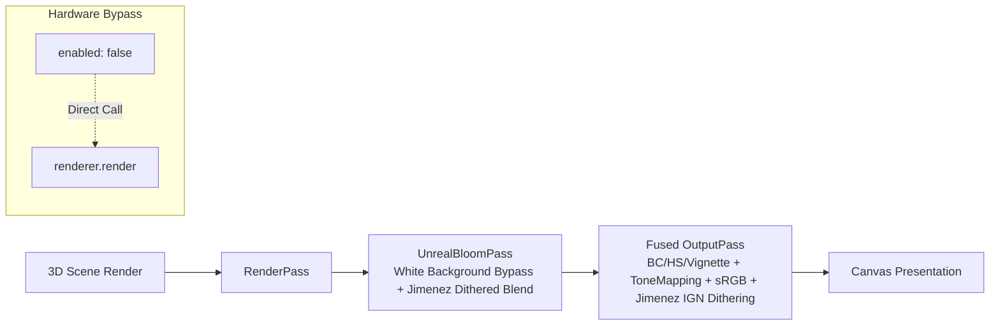

# Post-Processing Pipeline (PostFxPipeline)

> **Core Files**:  
> - [`src/core/postfx/postFxPipeline.ts`](../src/core/postfx/postFxPipeline.ts) (Post-processing pipeline implementation and custom shaders)  
> - [`src/components/dev-drawer/sections/PostFxSection.tsx`](../src/components/dev-drawer/sections/PostFxSection.tsx) (DevDrawer control panel)  
> - [`src/config.ts`](../src/config.ts) (`APP_CONFIG.postfx` default parameters and slider limits)

---

## 1. Design Objectives & Architecture Overview

In anime NPR (Non-Photorealistic Rendering / Cel-shading), generic post-processing configurations typical of realistic 3D games (such as aggressive screen bloom, heavy tone mapping curves, and dark vignetting) introduce two severe visual regressions:
1. **White-Background Fogging (Bloom Blowout)**: In bright or pure white outdoor scenes (e.g. minimalist linework), full-screen bloom treats high-luminance background pixels as glow emitters, causing the entire image to blow out in white haze and engulfing character silhouettes.
2. **Skin Tone Desaturation & Muddy Yellowing**: Realistic tone mappers (like ACESFilmic or Neutral) heavily compress highlights and midtones, turning fair, vibrant anime skin tones into dull grey or yellow hues.

To resolve these challenges, Project XiaoChun implements a tailored **`PostFxPipeline`** with the following pipeline structure:



---

## 2. Stage-by-Stage Technical Specifications

### 2.1 Physical Zero-Cost Render Bypass
- When `enabled = false`, the render loop **100% bypasses** `EffectComposer`, directly invoking native `renderer.render(this.scene, this.camera)`;
- Completely eliminates redundant FBO allocations, RenderTarget context switches, and full-screen quad blits during disabled states.
- **Transparent desk-pet uses the composer when PostFX is on** (MSAA lives on the main RT). Bloom high-pass skips `alpha < 0.04`; additive bloom writes RGB only so click-through alpha stays the scene silhouette.

### 2.2 Anti-Fogging UnrealBloomPass (Background Luminance Bypass)
- **Shader-level White Filtering**: Modifies the `LuminosityHighPass` shader logic to selectively reject pixels approaching pure white `(1.0, 1.0, 1.0)`. Bloom is strictly constrained to character hair highlights, clothing specular, and metallic accessories.
- **Calibrated Production Defaults**:
  ```typescript
  bloom: {
    strength: 0.015, // Subtle glow, transparent and soft hair edges, zero fogging
    radius: 0.32,    // Diffusion radius
    threshold: 0.72  // Specular threshold
  }
  ```

### 2.3 Fused Single-Pass Color Grading into OutputPass (Zero-Blit Optimization)
Previously, color adjustments ran inside a dedicated `ColorGradingPass` immediately before `OutputPass`. In 4K / high-DPI viewports, this incurred an entire extra full-screen FBO blit pass, consuming unnecessary GPU memory bandwidth and render target state changes.

`PostFxPipeline` fuses color grading directly into Three.js's native `OutputPass` fragment shader, executing before tone mapping:
1. **BC (Brightness & Contrast)**:
   - Linear contrast formula: `color = (color - 0.5) * (1.0 + contrast) + 0.5 + brightness`;
   - Defaults to a subtle `contrast: +0.02` to enhance iris depth and clarity.
2. **HS (Hue & Saturation)**:
   - Optimized RGB $\leftrightarrow$ HSV conversion; short-circuits trigonometric math when `saturation === 0 && hue === 0`.
3. **Vignette**:
   - Disabled by default in bright scenes (`darkness: 0.0`), preventing unsightly dirty halos around character perimeters.
4. **Performance Gain**:
   - **Eliminates 1 full-screen 4K FBO Blit Pass** per frame;
   - Saves ~1.2–2.0ms GPU frame time on integrated mobile GPUs and high-DPI Retina screens with zero visual degradation.

### 2.4 Tone Mapping Modes
Provides runtime switching across 5 tone mapping algorithms:
| Mode | Three.js Constant | Characteristics & Target Scenarios |
| :--- | :--- | :--- |
| **Linear (Default)** | `THREE.LinearToneMapping` | **Anime Recommended**. Pure color straight-through; preserves fair skin tones without midtone compression; paired with `exposure: 1.05`. |
| **ACESFilmic** | `THREE.ACESFilmicToneMapping` | Cinematic high dynamic contrast; best for heavy shadows and dark scenes. |
| **Neutral** | `THREE.NeutralToneMapping` | Khronos PBR standard tone curve; slightly compresses skin tones in anime settings. |
| **Reinhard** | `THREE.ReinhardToneMapping` | Classic soft highlight roll-off. |
| **Cineon** | `THREE.CineonToneMapping` | Film-stock response curve. |

### 2.5 Dual-Stage Jimenez IGN 8-Bit Dithering (Anti-Banding & Circular Halo Elimination)
In dark mode or high-contrast scenes, the subtle falloff of Gaussian bloom and smooth background gradients can cross the 8-bit framebuffer quantization threshold (e.g. from `rgb(16, 16, 16)` to `rgb(15, 15, 15)`). Due to Mach Banding and human contrast sensitivity (Weber's law), this produces visible stepped rings (circular halos) around character hair and highlights.

To eliminate this artifact without incurring heavy compute penalties, Jorge Jimenez's Interleaved Gradient Noise (IGN) is injected at **two critical pipeline stages**:
1. **Bloom Additive Blend (`compositeMaterial`)**:
   - Injected into UnrealBloom's multi-level additive blur synthesis pass to prevent quantization stepping while bloom levels are composited into HDR color buffers:
   ```glsl
   float ign = fract(52.9829189 * fract(dot(gl_FragCoord.xy, vec2(0.06711056, 0.00583715))));
   gl_FragColor.rgb += (ign - 0.5) / 255.0;
   ```
2. **Final Presentation (`OutputPass`)**:
   - Injected immediately following tone mapping and `sRGBTransferOETF` to smoothly disperse 1-bit quantization steps into human-imperceptible continuous gradients.

### 2.6 VRAM & Scene Graph Optimizations (Zero-Cost Hardening)
1. **Composer Ghost Buffer Release**: Three.js `EffectComposer` automatically allocates a ping-pong `renderTarget1` matching the main render target (including MSAA 4x). Because `RenderPass -> BloomPass -> OutputPass` directly reads and writes through dedicated targets, `renderTarget1` remained unreferenced in GPU memory. Manually calling `composer.renderTarget1.dispose()` frees **250MB–400MB** of wasted VRAM.
2. **Bloom Intermediate FBO Stripping**: The 11 internal ping-pong render targets of `UnrealBloomPass` only process 2D texture blur; stripping their `depthBuffer: false` and `stencilBuffer: false` saves ~15MB–25MB of redundant depth buffer memory allocations.
3. **Shadow Caster Pruning**: Redundant shadow casting on microscopic facial decal meshes (`iris`, `highlight`, `eyelash`, `eyebrow`, `eyeline`) is disabled, eliminating 5 redundant draw calls from the directional shadow map pass.
4. **Static Scene Graph Matrix Freezing**: Studio lights (`dirLight`, `fillLight`, `hemiLight`), their target nodes, and static root groups have `matrixAutoUpdate = false` enabled upon setup, eliminating CPU-side matrix multiplication recursions during the main render loop.

---

## 2.1 Platform render-target knobs (`APP_CONFIG`)

Internal composer resolution still follows `getRenderPixelRatio()` (see `APP_CONFIG.renderer.maxPixelRatioMobile` / `maxPixelRatioDesktop`). On top of that, PostFX exposes:

| Knob | Role |
|------|------|
| `postfx.bloomInputScaleMobile` / `bloomInputScaleDesktop` | Scale passed into `UnrealBloomPass.setSize` (Pass also halves once more). Mobile `0.3` / desktop `0.5`. |
| `postfx.composerMSAASamplesMobile` / `composerMSAASamplesDesktop` | Main RT MSAA sample count. Mobile `3` / desktop `4`. `0` disables MSAA. Outline needs some MSAA. Used for linework **and** transparent desk-pet whenever PostFX is on. |

Sim cadence (`renderer.targetFpsMobile` / `targetFpsDesktop`) is owned by `VRMEngine`’s animation loop, not by this pipeline.

## 3. DevDrawer Control Interface (`PostFxSection.tsx`)

Integrated as Section 7 in the developer drawer:
1. **Master Switch with Live Indicator**: Toggle switch with animated state lock/fade-out when disabled;
2. **ToneMapping Capsule Grid**: Interactive pill button matrix displaying real-time active mode;
3. **Calibrated Anchor Sliders**: Every slider features tick marks indicating 100% baseline and config defaults;
4. **Trilingual Support**: Fully localized in English, Chinese (zh-CN), and Japanese (ja).
