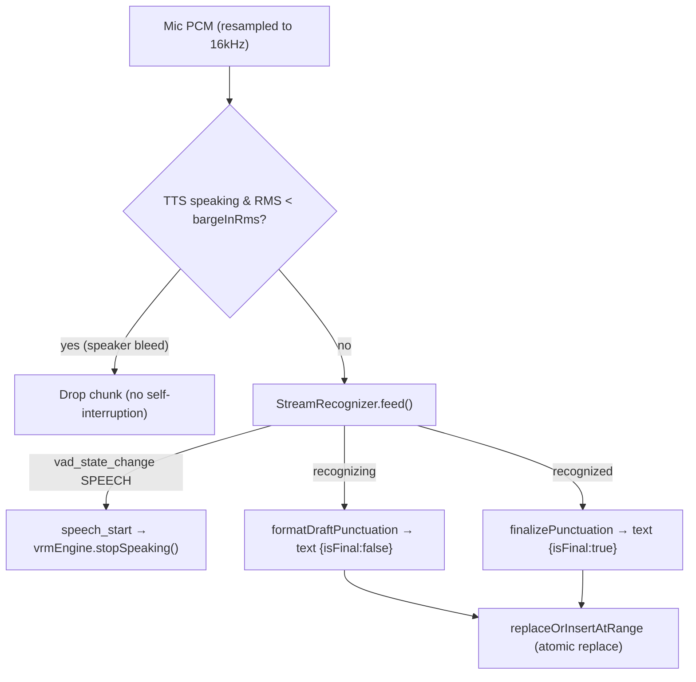

# On-Device Streaming STT (`STT.md`)

> **Core Files**:
> - [`src/stt/sttClient.ts`](../src/stt/sttClient.ts) — mic capture, `StreamRecognizer` (`@firetable/stream-asr`) bridge, 1:1 Worker FIFO sequence fence, acoustic bleed gating & barge-in guard, bounded PCM buffer
> - [`src/stt/punctuation.ts`](../src/stt/punctuation.ts) — heuristic punctuation (`formatDraftPunctuation`, `finalizePunctuation`) + multi-sentence CJK inter-segment comma normalization
> - [`src/components/VoicePill.tsx`](../src/components/VoicePill.tsx) — perimeter SVG progress/indeterminate loading ring, live Canvas waveform, Hold-to-Talk & slide-to-cancel gestures
> - [`src/components/ChatBar.tsx`](../src/components/ChatBar.tsx) — atomic in-place range replacement (`replaceOrInsertAtRange`), permanent controlled download `<Tooltip>`, cross-browser IME macrotask guard
> - [`src/config.ts`](../src/config.ts) — `APP_CONFIG.stt` (`modelUrl`, `wasmBaseUrl`, `vadThreshold`, `bargeInRms`, `ttsCooldownMs`)

## 1. Architecture

ChatBar dictation is **100% browser-native, single-pass streaming**, powered by [`@firetable/stream-asr`](https://github.com/FireTable/stream-asr) (WebAssembly SIMD, Mode 3: continuous streaming + neural VAD). Audio never leaves the device.

There is **no Two-Pass** stage: interim drafts and finals both come from the same on-device engine, so text never jumps due to a cloud re-transcription.

## 2. Model & Runtime

| Item | Location |
| :--- | :--- |
| Model manifest + chunks | `https://cdn.firetable.tech/stream-asr/v1/model_chunks/model.json` (override: `VITE_STREAM_ASR_MODEL_URL`) |
| WASM runtime | same-origin `/wasm/` (`public/wasm`, override: `VITE_STREAM_ASR_WASM_BASE`) |
| Cache | IndexedDB (managed by the SDK), offline after first download |

The model is downloaded lazily on first mic activation; `progress` events carry `phase` (`'download' | 'init' | 'ready'`), `percent` (**0–100**), `loaded`, and `total` bytes. `VoicePill` renders a single perimeter SVG arc (determinate during `download`, spinning arc during `init`), while `ChatBar` keeps a permanently mounted controlled `<Tooltip open={sttState === 'loading'}>` showing percentage, bytes, sliding-window speed, and ETA without ever unmounting `VoicePill` (preserving pointer capture for Hold-to-Talk).

## 3. Behaviour Invariants

- **Acoustic bleed guard**: while TTS speaks (plus `ttsCooldownMs` tail), chunks with RMS `< bargeInRms` are dropped; louder input is treated as barge-in.
- **1:1 Worker FIFO sequence fence (no ghost-paste)**: every `feed()` / `finish()` increments `sentFeedCount`; calling `resetSession()` (on cancel, manual input edits/deletions, or new turn start) advances `ignoreResultsUntilCount = sentFeedCount` and resets WASM `universalSegments` so in-flight Worker `RESULT`s never paste deleted speech back into the input, while pre-existing typed text outside `sttRangeRef` is preserved.
- **Bounded PCM buffer**: PCM kept for DevDrawer `utterance_result` is capped (~0.5 s preroll in silence, ~30 s per utterance once speech begins) — never grows unbounded while the mic is idle.
- **Recoverable failure & mic release (`failSession`)**: `init()` failure, mic permission denial, or Worker errors immediately stop active `MediaStream` tracks, reset `desiredActive`, destroy failed recognizer instances, and allow a clean single-click retry.
- **Cross-browser IME safety**: while composing, STT text is deferred and flushed via a `0ms` macrotask in `onCompositionEnd` so both Chromium (`input → compositionend`) and Safari / Tauri `WKWebView` (`compositionend → input`) finish candidate insertion first.

## 4. Cloud STT (hidden, retained)

The Cloudflare Workers AI endpoint (`POST /api/stt`, `src/server/sttHandler.ts`) and the custom-provider STT plumbing (`activeAudioModes.ts`, `customProvider/`) are **kept in the codebase but have no UI entry** — the settings dialog only exposes LLM and TTS tabs. `SttClient` always uses the on-device engine.
