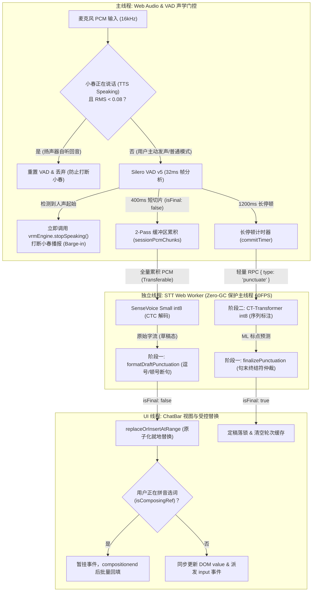

# On-Device STT & Dual-Stage Punctuation Pipeline (`STT.md`)

> **Core Files & Key Modules**:
> - [`src/stt/sttClient.ts`](../src/stt/sttClient.ts) — Web Audio capture, 2-Pass streaming accumulator, acoustic bleed gating & barge-in guard, RPC client
> - [`src/stt/sileroVad.ts`](../src/stt/sileroVad.ts) — Silero VAD v5 ONNX neural voice activity detector (32ms frames @ 16kHz)
> - [`src/stt/sttWorker.ts`](../src/stt/sttWorker.ts) — Web Worker thread hosting SenseVoice int8 ASR and CT-Transformer int8 punctuation models
> - [`src/stt/ctTransformerPunct.ts`](../src/stt/ctTransformerPunct.ts) — On-device CT-Transformer sequence tagger (272,727 token vocab, int8 ONNX, CacheStorage L2 cache)
> - [`src/stt/punctuation.ts`](../src/stt/punctuation.ts) — Two-stage punctuation pipeline orchestrator (`formatDraftPunctuation`, `finalizePunctuation`)
> - [`src/components/ChatBar.tsx`](../src/components/ChatBar.tsx) — Atomic in-place range replacement (`replaceOrInsertAtRange`), IME composition protection, zero-collapse autoresize
> - [`src/config.ts`](../src/config.ts) — Centralized `APP_CONFIG.stt` configuration knobs

---

## 1. Architecture & Pipeline Overview

Project XiaoChun features a **100% browser-native, zero-backend, multi-modal speech-to-text pipeline**. Aligned with industrial standards (OpenAI Realtime, FunASR, Deepgram), it employs a **2-Pass streaming accumulation architecture** with dual-state draft/commit separation and acoustic bleed suppression:



---

## 2. Models, Formats & CDN Persistence

| 模型组件 | 模型架构与规格 | 权重尺寸 | 默认 CDN 路径与持久化 Cache 桶 |
| :--- | :--- | :--- | :--- |
| **SenseVoice Small** | Multilingual CTC int8 (`zh/en/ja/ko/yue`) | ~228 MB (`model.int8.onnx` + `tokens.txt`) | `https://cdn.firetable.tech/xiaochun/stt/sensevoice-zh-en-ja-ko-yue-int8-2024-07-17/`<br/>CacheStorage 桶：`xiaochun-stt-v2024-07-17` |
| **Silero VAD v5** | Lightweight Neural VAD (`32ms @ 16kHz`) | ~2.1 MB (`silero_vad_v5.onnx`) | 本地静态路由 `/models/silero_vad_v5.onnx`<br/>CDN 兜底：`cdn.jsdelivr.net/.../silero_vad_v5.onnx` |
| **CT-Transformer** | Controllable Time-delay Transformer int8 | ~72 MB (`model.int8.onnx` + 4MB `tokens.json`) | `https://cdn.firetable.tech/xiaochun/stt/punct-ct-transformer-zh-en-vocab272727-int8-2024-04-12/`<br/>CacheStorage 桶：`xiaochun-punct-v2024-04-12` |

> [!NOTE]
> 首次开麦时按需懒加载下载模型，后续访问由浏览器标准 `CacheStorage` 离线接管，实现 **0 网络开销秒开**。全量推理均运行在 Web Worker 内部，主线程仅收发结构化消息，绝不挤占 Three.js 60 FPS 渲染主循环。

---

## 3. Dual-Stage Punctuation Pipeline (两阶段标点恢复管线)

针对长篇语音识别“字串连成一片、缺乏停顿与逻辑标点”的痛点，系统构建了**启发式规则（阶段一）与深度模型（阶段二）协同的流水线**：

### 3.1 阶段一：轻量启发式正则规范与断句
- **草稿态规范 (`formatDraftPunctuation`)**：
  - 用户仍在说话时，根据常见连词（如“但是”、“如果”、“因为”、“而且”等）和语气助词在句中插入逗号 `，`，**严禁添加句末终结符（`。`、`？`、`！`）**，为用户呈现连贯流动的“草稿态”交互；
- **定稿态终结符仲裁 (`finalizePunctuation`)**：
  - 严格仲裁句末语气：若句子末尾包含疑问词（“吗”、“呢”、“吧”、“好不好”、“行不行”等），强制收敛为问号 `？`；感叹词收敛为 `！`；陈述句收敛为 `。`。

### 3.2 阶段二：CT-Transformer 序列标注
- **分词器（Tokenizer）预清洗防护**：
  - 在词表编码前执行 `text.replace(/[\p{P}\p{S}]+/gu, ' ')`，剥离既有符号，防止中文全角标点混入被编码为 `<unk>`，消除 `，，` 或 `，。` 双重叠印缺陷；
- **轻量 RPC `{ type: 'punctuate' }`**：
  - 1200ms 长停顿定稿时，无需重新执行耗时的 SenseVoice ASR 全量特征提取，直接通过独立 RPC 发送文本至 Worker 内部的 CT-Transformer，~15ms 即可输出高精度的句中逗号与话题切分；
- **超时与降级容错（800ms Timeout Fallback）**：
  - 若模型下载中、离线或因 Web Worker 繁忙，800ms 超时后自动平滑降级至阶段一规则，保证输入框永远不卡死。

---

## 4. Multi-Modal Acoustic Bleed Gating & Barge-in Guard (扬声器防自听与主动打断)

### 4.1 声学漏音（Acoustic Bleed）痛点
在桌面宠物模式或笔记本外放扬声器环境下，小春播报的声音会从扬声器漏入麦克风。由于 Silero VAD 对高保真声音极其敏感，会将小春自己的声音判定为人声并触发 `speech_start`，造成**小春刚说话就被自己打断、输入框开始转录小春自己说的话**。

### 4.2 联动门控与主动插话机制
- **状态注入**：
  `sttClient.setTtsSpeakingProvider(() => vrmEngine.isSpeaking)` 将 TTS 播放状态注入到音频处理管道；
- **声学门限判断**：
  当处于 TTS 播放状态或 250ms 房间残响冷却窗内（`isGuardActive`）时：
  1. 计算当前 16kHz PCM 的 RMS 能量；
  2. 若 `rms < bargeInRms`（默认 `0.08`），判定为扬声器外放回音：
     - 调用 `this.vad.reset()` 冲刷预滚缓冲，防止小春声音渗入前置音频；
     - 派发 `partial_rms` 保证 VoicePill 波形动画实时跟随，但将 `prob` 设为 `0`；
     - 直接 `return` 丢弃切片，**不触发 `speech_start`，不累积语音片段**；
  3. 若 `rms >= bargeInRms`（默认 `0.08`），判定为用户主动凑近对麦克风发声（Barge-in）：
     - 放行音频进入 Silero VAD 进行神经网络置信度校验；
     - 校验通过后触发 `speech_start`，在 `ChatBar.tsx` 中立即调用 `vrmEngine.stopSpeaking()` 打断小春播报；
     - 清除残响冷却窗，无缝衔接用户发言。

---

## 5. UI Integration & Composer Invariants (输入框受控防护)

### 5.1 原子化区间替换 (`replaceOrInsertAtRange`)
- 在长段语音连续输入时，每次识别产生的草稿不是追加（append），而是**在原光标选区范围内进行就地原子替换**；
- 兼容 React 受控组件：通过 `HTMLTextAreaElement.prototype.value` setter 与 `setRangeText` 同步写入，并主动触发原生的 `input` 与 `change` 事件；
- 始终保持光标稳定停留在当前插入语音的最末端，彻底消除光标跳到文本首位或末尾乱跳的现象。

### 5.2 输入法（IME）合成态保护
- 在拼音选词阶段（`compositionstart` 到 `compositionend`），`isComposingRef.current` 置为 `true`；
- 语音识别结果暂存在 `pendingSttEventRef` 中，选词结束后在 `handleCompositionEnd` 中统一 flush 回写，杜绝语音打字冲掉用户候选词浮层；
- 区分用户物理键盘输入与语音脚本写入（`isSttInsertingRef`）：用户一旦手动打字，立即注销 `sttRangeRef`，绝不覆写用户手打文字。

### 5.3 消除输入框高度塌陷闪烁（Zero-Collapse Fix）
- 在自动高度计算函数 `syncComposerHeight` 中，严禁使用 `el.style.height = '0px'` 进行脏测量；
- 改用 `el.style.height = 'auto'`，并在当前微任务中同步写回计算出的最终像素高度 `${nextPx}px`，消除异步 React `setState` 引发的 1 帧高度塌陷黑闪。

### 5.4 轮次纪元与防幽灵文本（`currentTurnId` Epoch Guard）
- 用户点击发送消息或重置会话时，`sttClient.resetSession()` 自增 `currentTurnId`；
- 晚于发送时刻到达的在途识别结果与标点 RPC 会因为 `turnId !== currentTurnId` 被直接丢弃，彻底根绝发送后旧文本“幽灵复活”回填到空白输入框的严重 Bug。

---

## 6. Configuration Knobs (`src/config.ts`)

所有参数集中收敛在 `APP_CONFIG.stt`：

```ts
export const APP_CONFIG = {
  stt: {
    base: 'https://cdn.firetable.tech/xiaochun/stt/sensevoice-zh-en-ja-ko-yue-int8-2024-07-17',
    cacheName: 'xiaochun-stt-v2024-07-17',
    cacheKeyPrefix: 'xiaochun-stt/v2024-07-17',
    modelFile: 'model.int8.onnx',
    tokensFile: 'tokens.txt',
    useItn: true,
    sampleRate: 16_000,
    vadSilenceMs: 400,        // 短切片草稿停顿门限 (ms)
    commitSilenceMs: 1200,    // 长停顿自然定稿落锁门限 (ms)
    maxAccumulateMs: 15_000,  // 单轮最长录音切片累积上限 (ms)
    vadMaxMs: 20_000,         // Silero VAD 最大连续语音窗口
    vadPrerollMs: 300,        // 预滚缓冲 (ms)，防止首字爆破音丢失
    minUtteranceMs: 160,      // 超短语音噪声过滤门限 (ms)
    bargeInRms: 0.08,         // 扬声器防自听与用户主动插话打断能量门限 (RMS)
    ttsCooldownMs: 250,       // TTS 播报结束后的房间残响与声学回声吸收冷却窗 (ms)
    punctuation: {
      enabled: true,
      base: 'https://cdn.firetable.tech/xiaochun/stt/punct-ct-transformer-zh-en-vocab272727-int8-2024-04-12',
      modelFile: 'model.int8.onnx',
      tokensFile: 'tokens.json',
      cacheName: 'xiaochun-punct-v2024-04-12',
    },
  },
};
```

---

## 7. Multi-Modal STT Dispatcher & Remote Fallback (远程识别与智能熔断)

Project XiaoChun 采用 **“选定主线 + 失败直落本地兜底”** 的多模态语音识别架构，支持三种运行模式（由 `src/llm/activeAudioModes.ts` 管理）：

| 工作模式 | 核心服务与模型 | 失败/异常处理路径 |
| :--- | :--- | :--- |
| **官方内置智能 (推荐)** | 优先 Cloudflare Workers AI (`@cf/openai/whisper-large-v3-turbo`，通过 `/api/stt`) | 遇 429 额度耗尽或超时断网，断路器熔断 5 分钟，0ms 无缝降级到本地 SenseVoice |
| **用户自定义服务** | 用户自备 OpenAI 兼容接口 (`POST /v1/audio/transcriptions`，如 MiniMax ASR / Groq Whisper) | 遇 401 鉴权失败或连续超时，断路器熔断 5 分钟，0ms 无缝降级到本地 SenseVoice |
| **纯端侧离线 (Local Only)** | 100% 本地 WebWorker (SenseVoice int8 + CT-Transformer) | 声音不出本机，0 网络请求，极致离线隐私保护 |

### 7.1 轻量无损音频传输协议
- 文件：[`src/stt/wavEncoder.ts`](../src/stt/wavEncoder.ts)
- 麦克风录音采集的原始 16kHz Float32Array PCM 直接包裹标准 44 字节 WAV 头部打包为二进制流，零三方依赖，性能 < 1ms，杜绝浏览器端进行高 CPU 开销的有损重编码，与 OpenAI 及 Cloudflare 原生无缝对齐。

### 7.2 断路器与自愈机制 (Circuit Breaker)
- 文件：[`src/stt/sttDispatcher.ts`](../src/stt/sttDispatcher.ts)
- 连续 2 次请求超时或收到 HTTP 429 (配额用尽)，状态机标记该目标源熔断 5 分钟；
- 熔断窗口内，后续用户讲话 0ms 直接分发至本地 WebWorker 识别，免除等待超时的不良交互；
- 5 分钟后进入半开 (Half-open) 状态，放行一次请求探测远端恢复。

---

## 8. Agent Engineering Standards & Invariants (红线与守则)

1. ❌ **严禁在主线程导入重型 ML 模型**：
   SenseVoice 与 CT-Transformer 必须留在 `sttWorker.ts` 中执行，主线程只通过轻量 Transferable RPC 交互；
2. ❌ **严禁裸写 `commitSession()` 跳过 CT-Transformer**：
   自然定稿必须调用 `punctuateText()` RPC 经由 Worker 内部的 CT-Transformer 模型恢复标点并带 800ms 超时回退；
3. ❌ **严禁在输入框更新时使用 `el.style.height = '0px'`**：
   高度测量必须使用 `auto` 并在同帧写回像素值，防止 1 帧高度塌陷引发 UI 抽搐；
4. ❌ **严禁在小春说话时无门控转发麦克风语音**：
   必须通过 `bargeInRms` 与 `ttsCooldownMs` 双门限过滤扬声器回音，仅在确认用户主动发声打断时调用 `stopSpeaking()`；
5. ❌ **严禁对已熔断的远程源进行同步网络阻塞**：
   `isRemoteSttAvailable()` 返回 `false` 时必须 0ms 瞬间分发本地 Worker，绝不挂起主线程或超时卡顿；
6. ⚠️ **单测回归基准**：
   涉及 STT 模块的代码修改，必须确保 `pnpm vitest run src/stt/` 全部测试 100% 通过：
   - `ctTransformerPunct.test.ts`
   - `punctuation.test.ts`
   - `sileroVad.test.ts`
   - `sttClient.test.ts`
   - `sttDispatcher.test.ts`
   - `voiceSessionHistory.test.ts`
   - `wavEncoder.test.ts`
