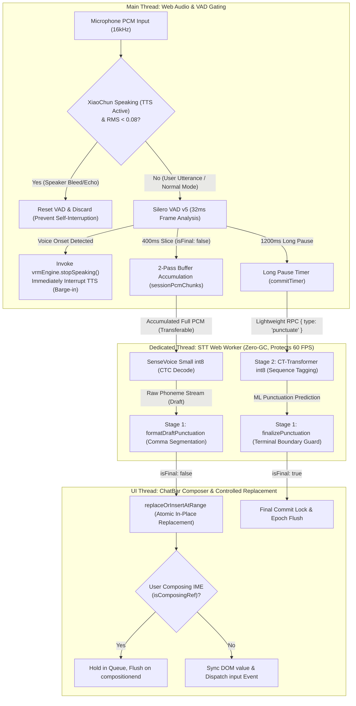

# On-Device STT & Dual-Stage Punctuation Pipeline (`STT.md`)

> **Core Files & Key Modules**:
> - [`src/stt/sttClient.ts`](../src/stt/sttClient.ts) — Web Audio capture, 2-Pass streaming accumulator, acoustic bleed gating & barge-in guard, RPC client
> - [`src/stt/sileroVad.ts`](../src/stt/sileroVad.ts) — Silero VAD v5 ONNX neural voice activity detector (32ms frames @ 16kHz)
> - [`src/stt/sttWorker.ts`](../src/stt/sttWorker.ts) — Web Worker thread hosting SenseVoice int8 ASR and CT-Transformer int8 punctuation models
> - [`src/stt/ctTransformerPunct.ts`](../src/stt/ctTransformerPunct.ts) — On-device CT-Transformer sequence tagger (272,727 token vocab, int8 ONNX, CacheStorage L2 cache)
> - [`src/stt/punctuation.ts`](../src/stt/punctuation.ts) — Two-stage punctuation pipeline orchestrator (`formatDraftPunctuation`, `finalizePunctuation`)
> - [`src/components/ChatBar.tsx`](../src/components/ChatBar.tsx) — Atomic in-place range replacement (`replaceOrInsertAtRange`), IME composition protection, zero-collapse autoresize
> - [`src/config.ts`](../src/config.ts) — Centralized `APP_CONFIG.stt` configuration knobs

---

## 1. Architecture & Pipeline Overview

Project XiaoChun features a **100% browser-native, zero-backend, multi-modal speech-to-text pipeline**. Aligned with industrial standards (OpenAI Realtime, FunASR, Deepgram), it employs a **2-Pass streaming accumulation architecture** with dual-state draft/commit separation and acoustic bleed suppression:



---

## 2. Models, Formats & CDN Persistence

| Component | Architecture & Specifications | Weight Size | Default CDN Path & Cache Storage Bucket |
| :--- | :--- | :--- | :--- |
| **SenseVoice Small** | Multilingual CTC int8 (`zh/en/ja/ko/yue`) | ~228 MB (`model.int8.onnx` + `tokens.txt`) | `https://cdn.firetable.tech/xiaochun/stt/sensevoice-zh-en-ja-ko-yue-int8-2024-07-17/`<br/>CacheStorage bucket: `xiaochun-stt-v2024-07-17` |
| **Silero VAD v5** | Lightweight Neural VAD (`32ms @ 16kHz`) | ~2.1 MB (`silero_vad_v5.onnx`) | Local static path: `/models/silero_vad_v5.onnx`<br/>CDN fallback: `cdn.jsdelivr.net/.../silero_vad_v5.onnx` |
| **CT-Transformer** | Controllable Time-delay Transformer int8 | ~72 MB (`model.int8.onnx` + 4MB `tokens.json`) | `https://cdn.firetable.tech/xiaochun/stt/punct-ct-transformer-zh-en-vocab272727-int8-2024-04-12/`<br/>CacheStorage bucket: `xiaochun-punct-v2024-04-12` |

> [!NOTE]
> Models are downloaded on-demand lazily upon first microphone activation. Subsequent visits are handled 100% offline via browser standard `CacheStorage` for **0 network latency instant launch**. All neural inference runs inside a Dedicated Web Worker; the main thread only exchanges structured Transferable messages, preventing any frame drops in the Three.js 60 FPS render loop.

---

## 3. Dual-Stage Punctuation Pipeline

To solve the classic problem of continuous ASR output lacking grammatical punctuation, the system employs a **cooperative pipeline combining heuristic regex rules (Stage 1) and deep neural models (Stage 2)**:

### 3.1 Stage 1: Lightweight Heuristic Regex Formatting & Segmentation
- **Draft Mode Formatting (`formatDraftPunctuation`)**:
  - While the user is speaking, commas `，` are inserted between clauses based on conjunctions and discourse markers. **Terminal punctuation (`。`, `？`, `！`) is strictly prohibited in draft mode**, ensuring a flowing, continuous interim typing experience.
- **Finalized Terminal Punctuation Arbitration (`finalizePunctuation`)**:
  - Intonation and mood particles at the sentence tail are strictly arbitrated: interrogative suffixes ("吗", "呢", "吧", "好不好", etc.) converge to `？`; exclamatory suffixes converge to `！`; declarative sentences converge to `。`.

### 3.2 Stage 2: CT-Transformer Sequence Tagging
- **Tokenizer Pre-Sanitation**:
  - Runs `text.replace(/[\p{P}\p{S}]+/gu, ' ')` before subword encoding to strip pre-existing punctuation. This prevents full-width Chinese punctuation from being tokenized as `<unk>` and eliminates duplicate punctuation marks like `，，` or `，。`.
- **Lightweight RPC `{ type: 'punctuate' }`**:
  - Upon a 1200ms pause finalization, the system avoids re-running the costly full-sequence SenseVoice acoustic feature extraction. Instead, it dispatches a lightweight text RPC to CT-Transformer in the Worker, generating accurate inter-clause commas and topical splits in ~15ms.
- **Timeout & Graceful Degradation (800ms Fallback)**:
  - If the model is downloading, offline, or the Web Worker is saturated, an 800ms timeout automatically falls back to Stage 1 heuristic rules, ensuring the text composer never hangs.

---

## 4. Multi-Modal Acoustic Bleed Gating & Barge-in Guard

### 4.1 Acoustic Bleed Challenge
In desktop pet mode or laptop speaker environments, XiaoChun's speech output echoes back into the microphone. Because Silero VAD is highly sensitive to voice harmonics, it detects the character's own speech as user input, triggering false `speech_start` events and causing **XiaoChun to interrupt herself and transcribe her own words into the chat box**.

### 4.2 Gating Linkage & Active Barge-in Mechanism
- **State Injection**:
  `sttClient.setTtsSpeakingProvider(() => vrmEngine.isSpeaking)` injects real-time TTS playback state into the audio processing pipeline.
- **Acoustic Energy Gating**:
  When TTS is actively playing or during the 250ms room reverberation cooldown window (`isGuardActive`):
  1. Computes the RMS energy of the incoming 16kHz PCM audio;
  2. If `rms < bargeInRms` (default `0.08`), the audio is classified as speaker echo/bleed:
     - Calls `this.vad.reset()` to flush preroll buffers, preventing residual audio from leaking into subsequent speech;
     - Dispatches `partial_rms` to keep VoicePill waveform animations responsive while forcing `prob = 0`;
     - Immediately returns and discards the slice: **does not trigger `speech_start`, does not accumulate audio segments**;
  3. If `rms >= bargeInRms` (default `0.08`), the audio is classified as deliberate user speech (Barge-in):
     - Passes audio through to Silero VAD for neural confidence validation;
     - Upon confirmation, triggers `speech_start`, immediately invoking `vrmEngine.stopSpeaking()` in `ChatBar.tsx` to stop XiaoChun's speech;
     - Clears the reverberation cooldown window and transitions seamlessly into user dictation.

---

## 5. UI Integration & Composer Invariants

### 5.1 Atomic Range Replacement (`replaceOrInsertAtRange`)
- During continuous speech recognition, interim drafts do not append to the textarea. Instead, they **atomically replace the text within the original cursor selection range in-place**;
- Full compatibility with React controlled components: writes synchronously via `HTMLTextAreaElement.prototype.value` setter and `setRangeText`, dispatching native `input` and `change` events;
- Keeps the caret firmly anchored at the end of the newly inserted dictation segment, eliminating cursor jumps to the start or end of the document.

### 5.2 IME Composition State Protection
- While the user is typing with an IME (from `compositionstart` to `compositionend`), `isComposingRef.current` is set to `true`;
- Incoming STT results are held in `pendingSttEventRef` and flushed in batch inside `handleCompositionEnd`, preventing voice recognition from stomping over active IME candidate popups;
- Differentiates physical keyboard input from voice script insertions (`isSttInsertingRef`): if the user types manually, `sttRangeRef` is deregistered immediately, preserving handwritten text.

### 5.3 Zero-Collapse Height Autoresize
- In `syncComposerHeight`, measuring with `el.style.height = '0px'` is strictly forbidden;
- Uses `el.style.height = 'auto'` and synchronously writes back the computed `${nextPx}px` in the same microtask, eliminating 1-frame height collapse flicker caused by asynchronous React `setState` cycles.

### 5.4 Epoch Guard Against Ghost Text (`currentTurnId`)
- When the user sends a message or resets the conversation, `sttClient.resetSession()` increments `currentTurnId`;
- In-flight ASR transcripts or punctuation RPCs arriving after submission are discarded if `turnId !== currentTurnId`, completely eradicating the bug where previous voice text mysteriously reappears in an emptied composer.

---

## 6. Configuration Knobs (`src/config.ts`)

All parameters are centralized under `APP_CONFIG.stt`:

```ts
export const APP_CONFIG = {
  stt: {
    base: 'https://cdn.firetable.tech/xiaochun/stt/sensevoice-zh-en-ja-ko-yue-int8-2024-07-17',
    cacheName: 'xiaochun-stt-v2024-07-17',
    cacheKeyPrefix: 'xiaochun-stt/v2024-07-17',
    modelFile: 'model.int8.onnx',
    tokensFile: 'tokens.txt',
    useItn: true,
    sampleRate: 16_000,
    vadSilenceMs: 400,        // Short-slice draft pause threshold (ms)
    commitSilenceMs: 1200,    // Long pause natural finalization threshold (ms)
    maxAccumulateMs: 15_000,  // Single-session max accumulated PCM slice ceiling (ms)
    vadMaxMs: 20_000,         // Silero VAD max continuous utterance window
    vadPrerollMs: 300,        // Preroll buffer (ms) to preserve onset plosives
    minUtteranceMs: 160,      // Transient noise rejection threshold (ms)
    bargeInRms: 0.08,         // Acoustic bleed gate & user barge-in energy threshold (RMS)
    ttsCooldownMs: 250,       // Post-TTS reverberation and echo absorption cooldown window (ms)
    punctuation: {
      enabled: true,
      base: 'https://cdn.firetable.tech/xiaochun/stt/punct-ct-transformer-zh-en-vocab272727-int8-2024-04-12',
      modelFile: 'model.int8.onnx',
      tokensFile: 'tokens.json',
      cacheName: 'xiaochun-punct-v2024-04-12',
    },
  },
};
```

---

## 7. Multi-Modal STT Dispatcher & Remote Fallback

Project XiaoChun adopts a **"Preferred Remote Primary + Zero-Latency Local Fallback"** multi-modal STT architecture, supporting three operating modes (managed by `src/llm/activeAudioModes.ts`):

| Operating Mode | Primary Service & Model | Failure / Exception Fallback Path |
| :--- | :--- | :--- |
| **Official Built-in AI (Recommended)** | Cloudflare Workers AI (`@cf/openai/whisper-large-v3-turbo` via `/api/stt`) | Upon 429 quota exhaustion or network timeout, the circuit breaker trips for 5 minutes with seamless 0ms fallback to local SenseVoice |
| **Custom User Provider** | User-configured OpenAI-compatible endpoint (`POST /v1/audio/transcriptions`, e.g., MiniMax ASR / Groq Whisper) | Upon 401 auth error or consecutive timeouts, the circuit breaker trips for 5 minutes with seamless 0ms fallback to local SenseVoice |
| **Pure On-Device (Local Only)** | 100% local Web Worker (SenseVoice int8 + CT-Transformer) | Audio never leaves the client device, 0 network requests, maximum offline privacy protection |

### 7.1 Lightweight Lossless Audio Transmission
- File: [`src/stt/wavEncoder.ts`](../src/stt/wavEncoder.ts)
- Raw 16kHz Float32Array PCM captured from the microphone is wrapped in a standard 44-byte WAV header and serialized into a binary stream. With zero third-party dependencies and < 1ms execution time, it avoids high-CPU lossy client-side re-encoding and natively matches OpenAI and Cloudflare audio endpoints.

### 7.2 Circuit Breaker & Self-Healing
- File: [`src/stt/sttDispatcher.ts`](../src/stt/sttDispatcher.ts)
- Upon 2 consecutive request timeouts or HTTP 429 (rate limit / quota exceeded), the state machine marks the remote target as tripped for 5 minutes;
- During the cooldown window, subsequent user utterances are dispatched to the local Web Worker with 0ms latency, avoiding sluggish timeouts;
- After 5 minutes, the circuit breaker enters the Half-Open state, allowing a single probe request to check for remote service recovery.

### 7.3 Client-Cloud 2-Pass Hybrid Mode
- **Pass 1 (Interim Draft · Instant Local Streaming)**:
  While the user speaks, each audio slice emitted by Silero VAD is marked on the main thread as `isFinal = false` and continuously dispatched to the **local on-device Web Worker (SenseVoice int8)** (~100ms ultra-low latency). `replaceOrInsertAtRange` updates the input composer atomically in-place, achieving real-time typewriter visual feedback with 0 network requests and 0 latency.
- **Pass 2 (Finalized Commit · Cloud Sentence Rewrite)**:
  When the user pauses for 1.2 seconds (`commitSilenceMs`) or turns off the microphone, `commitSession()` is invoked:
  1. Extracts the full accumulated PCM audio from the session (`combinedPcm`);
  2. If the remote service is healthy, **only 1 remote request for the entire sentence** is dispatched to Cloudflare Whisper Large v3 Turbo (or custom provider);
  3. Whisper Turbo leverages full acoustic context to produce a high-precision, multilingual, correctly capitalized final transcript;
  4. The transcript seamlessly replaces the earlier local draft via `replaceOrInsertAtRange` and locks the final state;
  5. **0ms Fallback**: If the cloud request times out or errors, the system automatically preserves the local SenseVoice draft and finalizes punctuation via local CT-Transformer, providing an uninterrupted user experience.

### 7.4 User-Configurable Strategy: Direct Cloud vs. 2-Pass Hybrid
In the "Provider Settings -> STT Recognition" panel, when cloud services (Official Built-in AI / Custom Provider) are enabled, users can freely toggle the dictation strategy:
- **☁️ Direct Cloud (`direct`, Default Recommended)**:
  - While speaking: **completely avoids loading the 40MB local SenseVoice model**, saving memory, bandwidth, and inference compute;
  - The microphone only runs lightweight Silero VAD slicing and audio accumulation;
  - Upon release/pause: dispatches a single request to cloud Whisper Turbo for the final result. If the cloud fails, it seamlessly spins up the local Worker as a fallback.
- **⚡ 2-Pass Real-Time Preview (`2pass`)**:
  - While speaking: local Web Worker (SenseVoice int8) streams draft words with ~100ms instant feedback;
  - Upon release/pause: sends the merged sentence once to Cloudflare Whisper Turbo / Custom Cloud for high-fidelity rewriting and final punctuation.
- **📱 Pure On-Device Local (`local`)**:
  - 100% runs locally on-device. Audio never leaves the machine with zero network traffic.

---

## 8. Agent Engineering Standards & Invariants

1. ❌ **Never import heavy ML models on the main thread**:
   SenseVoice and CT-Transformer must stay strictly inside `sttWorker.ts`; the main thread communicates exclusively via lightweight Transferable RPCs;
2. ❌ **Never write naked `commitSession()` calls that bypass CT-Transformer**:
   Natural finalization must invoke the `punctuateText()` RPC through the Worker's CT-Transformer model with an 800ms timeout fallback;
3. ❌ **Never use `el.style.height = '0px'` when resizing the textarea**:
   Height measurement must use `'auto'` and write back the computed pixel height within the same frame to prevent 1-frame height collapse flicker;
4. ❌ **Never forward raw microphone audio without gating while XiaoChun is speaking**:
   Must enforce `bargeInRms` and `ttsCooldownMs` dual thresholds to filter out speaker feedback, only invoking `stopSpeaking()` when the user deliberately interrupts;
5. ❌ **Never synchronously block on a tripped remote endpoint**:
   When `isRemoteSttAvailable()` returns `false`, audio must instantly dispatch to the local Worker with 0ms delay, never hanging the main thread;
6. ⚠️ **Regression Testing Discipline**:
   Any code changes involving the STT module must verify that all unit tests under `pnpm vitest run src/stt/` pass 100%:
   - `ctTransformerPunct.test.ts`
   - `punctuation.test.ts`
   - `sileroVad.test.ts`
   - `sttClient.test.ts`
   - `sttDispatcher.test.ts`
   - `voiceSessionHistory.test.ts`
   - `wavEncoder.test.ts`
