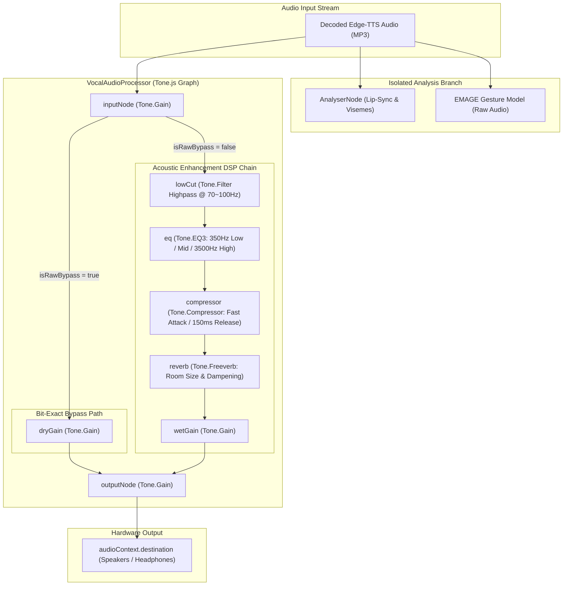

# Edge TTS Proxy (`/api/tts`) & Client Vocal Post-Processing

> **Core Files**:
> - [`src/server.ts`](../src/server.ts) — Cloudflare Worker `/api/tts`: single-flight Edge TTS WebSocket proxy, retry, edge cache, 502 with `reasons`
> - [`src/lib/edge-tts-core.ts`](../src/lib/edge-tts-core.ts) — endpoints, `TRUSTED_CLIENT_TOKEN`, `Sec-MS-GEC` (v1), SSML / frame parsing
> - [`src/director/vocalProcessor.ts`](../src/director/vocalProcessor.ts) — Web Audio & Tone.js 15.x DSP pipeline (`VocalAudioProcessor`), 3D distance attenuation, bit-exact bypass routing
> - [`vite/localApiPlugin.ts`](../vite/localApiPlugin.ts) — dev-only `/api/tts`: proxies to `TTS_PROXY_URL` (Node `fetch`, UA `node`) or connects Edge directly
>
> **Related**: client chunking, parallel prefetch and text fallback on TTS failure → [`CHAT_DIRECTOR.md`](CHAT_DIRECTOR.md).

---

## 1. Request / Response

`POST /api/tts` (or `GET ?text=&voice=&pitch=&rate=&volume=`), body `{ text, voice?, pitch?, rate?, volume? }`:
- `voice`: target voice (defaults to `zh-CN-XiaoyiNeural`)
- `pitch`: pitch offset (defaults to `+10Hz`)
- `rate`: speaking rate change with percentage (defaults to `+0%`, e.g. `+20%`, `-10%`)
- `volume`: volume gain (defaults to `+0%`, e.g. `+15%`)

| Result | Status | Body / Headers |
| :-- | :-- | :-- |
| Success | 200 | `audio/mpeg` stream (MP3, 24 kHz mono 48 kbps), `X-TTS-Cache: MISS \| HIT \| R2-HIT`, `X-TTS-Storage: r2 \| r2+pop \| pop \| none` |
| Empty text | 400 | `{"error":"text is required"}` |
| Upstream failure | 502 | `{"error": "<root cause> (after N attempts)", "reasons": [...]}` |

### 1.1 3-Tier Multi-Layer Caching Architecture

To guarantee low latency, high availability under concurrency, and persistent audio retention, `/api/tts` employs a 3-tier progressive caching architecture:

1. **L1 Edge PoP Memory Cache (`caches.default`)**:
   - Response latency: **< 15 ms**
   - Eviction lifecycle: Short-term hot cache governed by Cloudflare's PoP-local LRU memory reclamation
   - Response header: `X-TTS-Cache: HIT`
2. **L2 R2 Object Storage Persistent Cache (`TTS_BUCKET` -> `xiaochun-tts`)**:
   - Response latency: **20 ~ 50 ms**
   - Eviction lifecycle: Permanent retention, cross-region sharing, 0 egress bandwidth fees
   - On cache hit, asynchronously backfills the current PoP's L1 cache for subsequent < 15ms requests
   - Response header: `X-TTS-Cache: R2-HIT`
   - Object path: `v1/${voice}/${hashKey}.mp3`
   - Compound cache key: `hashKey = SHA-256(voice|pitch|rate|volume|text)`, strictly isolating different speed, pitch, and volume parameters to prevent cross-prosody audio collisions
3. **L3 Edge-TTS Upstream Live Synthesis**:
   - Response latency: **~1.0 s** time-to-first-byte (TTFB) stream
   - Response header: `X-TTS-Cache: MISS`
   - Automatically dual-writes to both L1 and L2 asynchronously via `ctx.waitUntil` upon stream completion

### 1.2 Open-Source Zero-Config & Graceful Degradation Guarantee

Open-source deployments are fully decoupled from R2 persistent storage via duck-typing:
- **Enable R2 Persistent Cache (Recommended)**:
  ```bash
  # 1. Create the R2 bucket (one-time setup)
  pnpm run setup:tts-cache
  # 2. wrangler.jsonc includes the TTS_BUCKET binding by default; deploy directly
  pnpm run deploy
  ```
- **Deploy Without R2 Persistent Cache**:
  If a user has no Cloudflare R2 allocation, simply delete or comment out the `r2_buckets` section in `wrangler.jsonc`. The Worker runtime detects `env.TTS_BUCKET === undefined` and seamlessly falls back to `L1 PoP Memory Cache + L3 Live Synthesis` with zero runtime exceptions or deployment barriers.

### 1.3 Standalone Dedicated TTS Microservice Worker (`xiaochun-tts`)

Project XiaoChun supports deploying the TTS subsystem as a pure, standalone microservice completely decoupled from the main website:
- **Entry point**: [`src/tts-worker.ts`](../src/tts-worker.ts) (shares [`src/server/ttsHandler.ts`](../src/server/ttsHandler.ts) with the main site)
- **Configuration**: [`wrangler.tts.jsonc`](../wrangler.tts.jsonc)
- **Instant Deployment**:
  ```bash
  # Deploy standalone TTS microservice (only 34 KiB, 0 frontend dependencies, second-level deployment)
  pnpm run deploy:tts
  ```
- **Live Endpoint**: `https://xiaochun-tts.firetable.workers.dev`
  - `GET /` or `/health`: Returns service health status and R2 capability readiness
  - `POST /api/tts` or `GET /api/tts?text=...`: Standard 5D prosody matrix streaming speech synthesis
  - Can be populated directly into `.env.local` as `TTS_PROXY_URL` for local development or Tauri desktop client use.

### 1.4 Audio Encoding Benchmark & Codec Evaluation (MP3 vs Opus vs OGG)

To evaluate whether the default 48 kbps MP3 should be replaced by theoretically higher-compression formats like Opus or OGG to save R2 storage and network bandwidth, we conducted two-round benchmarks against Microsoft's live Edge-TTS upstream interface using identical text payloads.

#### 1.4.1 Live Edge-TTS Upstream Benchmark Data

Test payload: `"你好呀，我是小蠢，今天海边的风很舒服，我们一起去散步吹吹风吧！"`

| Output Format Specifier (`outputFormat`) | Upstream Support | Time to First Byte (TTFB) | Total Stream Duration | Total Transfer Size | Chunk Count | Format Profile |
| :--- | :--- | :--- | :--- | :--- | :--- | :--- |
| **`audio-24khz-48kbitrate-mono-mp3` (Current)** | **Supported** | **998 ~ 1,094 ms** | **1,088 ~ 1,281 ms** | **39.7 ~ 43.9 KB** | 56 ~ 62 chunks | Industry-standard streaming MP3, frame-level self-contained |
| **`webm-24khz-16bit-mono-opus`** | **Supported** | **716 ~ 1,114 ms** | **883 ~ 1,389 ms** | **42.0 ~ 46.5 KB** | 359 ~ 397 chunks | WebM (Matroska) containerized Opus audio stream |
| **`ogg-24khz-16bit-mono-opus`** | **Unsupported (Timeout)** | **No data (0 Bytes)** | Timed out | 0 KB | 0 chunks | Free Edge-TTS endpoint does not provide OGG containers |
| **`ogg-16khz-16bit-mono-opus`** | **Unsupported (Timeout)** | **No data (0 Bytes)** | Timed out | 0 KB | 0 chunks | Same as above; Microsoft reserves OGG for paid Azure Speech tiers |

#### 1.4.2 Key Benchmark Conclusions

1. **Synthesis & Streaming Latency: Identical Millisecond Tier**
   - TTFB fluctuates between **0.7s ~ 1.1s**, and total completion takes **1.1s ~ 1.3s**, differing by only tens of milliseconds (primarily driven by Microsoft cloud GPU scheduling queues). Opus exhibits no meaningful throughput speedup.
2. **Container Compatibility: Edge-TTS Does Not Support OGG, Only WebM Opus**
   - The free Edge-TTS endpoint silently drops or times out on `ogg-` requests.
   - The only functional Opus container is WebM (`webm-24khz-16bit-mono-opus`), which aligns with Chromium's internal streaming media pipeline.
3. **Payload Size: WebM Opus Offers No Size Advantage Under Edge-TTS**
   - While bare Opus can theoretically save ~50% space at 16~24 kbps, the free Edge-TTS service does not expose target bitrate tuning and produces high dynamic bitrates.
   - WebM splits audio into hundreds of tiny fragments (~400 chunks), each carrying Matroska SimpleBlock header overhead. Consequently, the final payload (~44 KB) is slightly larger than 48 kbps MP3 (~41 KB).

#### 1.4.3 Client-Side Architecture Breakdown

- **Tone.js (Vocal DSP Engine)**:
  - **Completely codec-agnostic**. Tone.js operates in the Web Audio graph on uncompressed Float32 PCM arrays, handling EQ3 equalization, dynamic compression, reverb, and 3D camera distance attenuation.
- **ChatDirector Host Audio (`speakAudio`)**:
  - **Universal format support**. Delegates to browser-native `AudioContext.decodeAudioData`, supporting MP3, WAV, AAC, FLAC, and WebM/Opus out of the box.
- **ChatDirector Live TTS Pipeline (`streamChunkAudioToCheckpoint`)**:
  - **Optimized for streaming MP3**. To allow the 3D avatar to drive bone animation and RMS lipsync within hundreds of milliseconds of the first packet, it employs a lightweight C-WASM `mpg123-decoder` for chunk-by-chunk PCM extraction. Switching to Opus would require adding a container demuxer and Opus WASM decoder (adding ~80 KiB to the frontend bundle).

#### 1.4.4 Final Architectural Decision
Retain default **`audio-24khz-48kbitrate-mono-mp3`**:
- **Ultra-compact**: ~6 KB/s, only 20~30 KB per sentence. Cloudflare R2's free 10 GB tier comfortably stores over 300,000 sentences.
- **Zero bundle overhead**: Eliminates the need for WebM demuxers or additional WASM decoders.
- **100% universal compatibility**: Plays reliably with low latency across legacy iOS Safari, Android WebViews, and desktop clients.

## 2. Upstream Connection

| Item | Value |
| :-- | :-- |
| Primary endpoint | `wss://speech.platform.bing.com/consumer/speech/synthesize/readaloud/edge/v1?TrustedClientToken=<TRUSTED_CLIENT_TOKEN>` |
| Fallback endpoint | `wss://api.msedgeservices.com/tts/cognitiveservices/websocket/v1?Ocp-Apim-Subscription-Key=<TRUSTED_CLIENT_TOKEN>` |
| Token | `Sec-MS-GEC` v2 = CS64 + SHA-256 (`<16 hex>-<64 hex>`), `Sec-MS-GEC-Version=2-143.0.3650.75` |
| Per round | **one** request (no parallel hedging) |
| Rounds | up to 3; 429 → wait 3 s; other errors → 200–400 ms backoff |
| Budget | ~7 s total (a retry is skipped if wait + 3.5 s would exceed it), so the client's 8 s `withTimeout` still receives the 502 |
| First-chunk timeout | 3.5 s per flight |
| Errors | `AggregateError` is unwrapped to the real cause (`Handshake failed: HTTP 403`, `Upstream rejected: …`, timeout); distinct per-round causes go into `reasons` |

## 3. Troubleshooting / 2026-10 Upstream 403 Incident

### 3.1 Symptoms
- Every production `POST /api/tts` returned **502** `{"error":"All promises were rejected"}` for ~half a day (2026-10-14).
- Worker logs: `outcome: ok`, wallTime ~1.7 s, cpu ~8 ms; `Hedged Round #1..#4 failed: All promises were rejected` (the old hedged code hid the real cause).
- The app showed TTS-failure text fallback (see `CHAT_DIRECTOR.md`).

### 3.2 Diagnosis
1. `curl` production → 502 + the opaque aggregate message.
2. `npx wrangler tail project-xiaochun --format json` while sending one request → four failed rounds, no exception.
3. `npx wrangler deployments list --name project-xiaochun` → no TTS code change around the onset (`edge-tts-core.ts` untouched since 2026-09); a deploy happened to coincide in time.
4. Direct WebSocket handshake from a dev Mac (curl with `Upgrade: websocket`):
   - legacy host + v1 token, version `1-143…` → **403**; version `2-143…` → **403**
   - new host `api.msedgeservices.com` + same v1 token → **101**
5. Ruled out clock skew: `curl -sI https://speech.platform.bing.com | grep -i date` matched local UTC to the second.
6. Ruled out IP ban: `…/readaloud/voices/list?trustedclienttoken=…` still **200**.
7. Upstream: [rany2/edge-tts#490](https://github.com/rany2/edge-tts/issues/490) — from 2026-10-10 Microsoft rolled out a **v2 `Sec-MS-GEC`** (`<16 hex>-<64 hex>`, `Sec-MS-GEC-Version=2-155…`) region by region; the legacy host rejects v1 tokens. Fixed in edge-tts **7.3.0**; the community workaround is the new host with the old v1 token.

### 3.3 Root Cause
Microsoft-side protocol change: the legacy synthesis host now requires a v2 token. Our constants were up to date with edge-tts 7.2.x; bumping only the version string does not help.

### 3.4 Fix
Switch to the new host + `Ocp-Apim-Subscription-Key` (legacy fallback on 403), replace hedged dual-flight with single-flight rounds, 429 backoff, 7 s budget, 3.5 s first-chunk timeout, keep AggregateError unwrapping with `reasons` (§2). `vite/localApiPlugin.ts` direct mode uses the new host too.

### 3.5 Local Verification
The full Worker entry imports TanStack SSR and does not bundle standalone with `wrangler dev`, so a harness copies `src/server.ts` with the SSR handler stubbed:

```bash
mkdir -p grok/ttsharness
sed "s#^import handler from '@tanstack/react-start/server-entry';#const handler = { fetch: async () => new Response('stub', {status: 404}) };#; s#'./lib/#'../../src/lib/#g" \
  src/server.ts > grok/ttsharness/entry.ts
echo '{"name":"tts-harness","main":"entry.ts","compatibility_date":"2026-01-01","compatibility_flags":["nodejs_compat"]}' > grok/ttsharness/wrangler.json
npx wrangler dev -c grok/ttsharness/wrangler.json --local --port 8799 --ip 127.0.0.1
curl -s -o /tmp/t.mp3 -D - -X POST http://127.0.0.1:8799/api/tts \
  -H 'Content-Type: application/json' -d '{"text":"你好，小蠢正在说话。"}'
afinfo /tmp/t.mp3   # macOS: duration
```

Result (workerd, 5 sequential distinct texts): all **200** `audio/mpeg`, 24.6–25.8 KB, ~4.1–4.3 s audio, TTFB 0.82–1.22 s, total 1.1–1.5 s, no 429, no legacy fallback; repeat request `X-TTS-Cache: HIT` in 4 ms.

> Note: `pnpm dev` (5185) does **not** run `src/server.ts`; with `TTS_PROXY_URL` set it forwards to the remote Worker, so it mirrors production behaviour.

### 3.6 Next Time
```bash
# 1. real cause from production (502 body carries reasons)
curl -sS -X POST https://xiaochun.firetable.tech/api/tts -H 'Content-Type: application/json' -d '{"text":"你好"}'
# 2. live logs
npx wrangler tail project-xiaochun --format json
# 3. raw handshake (expect 101); swap host / version to compare
TOK=6A5AA1D4EAFF4E9FB37E23D68491D6F4
GEC=$(node -e "let t=Date.now()/1000+11644473600;t-=t%300;t*=1e7;console.log(require('crypto').createHash('sha256').update(t.toFixed(0)+'$TOK').digest('hex').toUpperCase())")
curl -s -m 10 -o /dev/null -w '%{http_code}\n' --http1.1 \
  "https://api.msedgeservices.com/tts/cognitiveservices/websocket/v1?Ocp-Apim-Subscription-Key=$TOK&Sec-MS-GEC=$GEC&Sec-MS-GEC-Version=1-143.0.3650.75&ConnectionId=$(uuidgen|tr -d -)" \
  -H 'Connection: Upgrade' -H 'Upgrade: websocket' -H 'Sec-WebSocket-Version: 13' \
  -H "Sec-WebSocket-Key: $(openssl rand -base64 16)" -H 'Origin: chrome-extension://jdiccldimpdaibmpdkjnbmckianbfold' \
  -H 'User-Agent: Mozilla/5.0 (Windows NT 10.0; Win64; x64) AppleWebKit/537.36 (KHTML, like Gecko) Chrome/143.0.0.0 Safari/537.36 Edg/143.0.0.0'
# (a 101 holds the socket open; curl exits on -m timeout — that is expected)
# 4. clock & IP sanity
curl -sI https://speech.platform.bing.com | grep -i '^date'; date -u
# 5. upstream: check rany2/edge-tts issues / latest constants.py & drm.py
```
A 403 says nothing about *why* (bad token, version, or host all look the same) — compare against the latest edge-tts release.

### 3.7 Long-Term Risk
- Microsoft may start requiring the v2 token on the new host as well. The fix would be porting edge-tts 7.3.0's v2 generator (PR #492). That algorithm is reconstructed from `msedge.dll` and embeds a Microsoft copyright string — **review the legal implications before adopting it**.
- `/api/tts` is unauthenticated with CORS `*`; third-party callers (e.g. Node clients on VPS IPs) consume upstream quota and raise 429 risk.

---

## 4. Client-Side Vocal Post-Processing Pipeline & 3D Spatial Acoustics

> **Core Files**:
> - [`src/director/vocalProcessor.ts`](../src/director/vocalProcessor.ts) — Web Audio & Tone.js 15.x DSP pipeline (`VocalAudioProcessor`), bit-exact bypass routing, 3D distance attenuation curve, safe parameter ramping
> - [`src/config.ts`](../src/config.ts) — Vocal presets (`bypass`, `sweet`, `oneesan`, `radio`, `whisper`), default configuration (`bypass` + `distanceAttenuation: true`), 3D camera acoustic bounds
> - [`src/director/chatDirector.ts`](../src/director/chatDirector.ts) — Signal routing insertion (`sourceNode -> vocalProcessor -> destination`) and viseme isolation
> - [`src/components/dev-drawer/sections/VocalSection.tsx`](../src/components/dev-drawer/sections/VocalSection.tsx) — Real-time acoustics control, live spatial distance badges (`near` / `standard` / `mid` / `far`), parameter sliders

While `/api/tts` synthesizes raw Microsoft Edge-TTS audio at the edge, Project XiaoChun features an advanced **in-browser DSP vocal post-processing pipeline** powered by Web Audio API and Tone.js 15.x. It delivers broadcast-quality vocal presence, anime warmth, and dynamic 3D camera distance acoustics directly on the client.

### 4.1 Architecture & Separation of Concerns

To guarantee that post-processing never degrades motion fidelity or introduces visual artifacts, the audio processing is strictly decoupled across functional domains:

1. **Viseme & Motion Isolation**:
   - The lip-sync analyzer (`AnalyserNode`) and EMAGE co-speech gesture engine receive the **raw, unadulterated audio stream** before any DSP coloration.
   - Reverb tails, dynamic compression, and EQ boosts never leak into viseme energy calculation or body gesture prediction.
2. **Bit-Exact Pure Bypass Branch**:
   - When the user selects the default `bypass` (原声直通) preset or disables vocal enhancement, audio travels exclusively through a dedicated `dryGain` bypass node (`inputNode -> dryGain -> outputNode`).
   - The signal completely skips the filter, EQ, compressor, and reverb nodes, ensuring zero phase shift, zero harmonic distortion, and 100% digital parity with raw Edge-TTS.
3. **Decoupled Control State**:
   - Switching acoustic presets modulates **only** DSP slider parameters (low cut, EQ gains, compressor threshold/ratio, reverb wet/size). It **never** mutates the user's top-level switches (`enabled`, `sceneLinkage`, `distanceAttenuation`).
4. **Zero-Glitch Live Automation**:
   - All acoustic parameters support smooth microsecond ramps (`rampTime = 0.03s`), allowing live adjustment from the DevDrawer during active playback without clicks, pops, or audio dropouts.
5. **Robust Headless Fallback**:
   - In SSR, Node.js unit test environments, or older browsers without Web Audio context support, the processor smoothly degrades to a native passthrough node without crashing.

### 4.2 Signal Routing & Processing Graph



### 4.3 3D Camera Distance Attenuation & Spatial Zoning

Project XiaoChun links the 3D orbit camera distance to the vocal acoustics, simulating realistic auditory perspective.

#### 4.3.1 Distance-to-Acoustic Mapping Algorithm

The acoustic mapping distinguishes three primary distance domains:

$$\begin{aligned}
d_{\text{min}} &= 0.6\,\text{m} \quad (\text{Minimum camera approach}) \\
d_{\text{ref}} &= 2.2\,\text{m} \quad (\text{Reference conversation distance}) \\
d_{\text{drop}} &= 8.0\,\text{m} \quad (\text{Attenuation start threshold}) \\
d_{\text{max}} &= 15.0\,\text{m} \quad (\text{Maximum stage vista})
\end{aligned}$$

1. **Near-Field Proximity Boost ($0.6\,\text{m} \le d < 2.2\,\text{m}$)**:
   - As the camera pushes close to XiaoChun, the voice increases in volume and gains chest warmth, recreating an intimate, close-mic ear-whispering sensation.
   - **Interpolation factor**: $t = \frac{d_{\text{ref}} - d}{d_{\text{ref}} - d_{\text{min}}} \in [0, 1]$
   - **Chest Resonance (EQ Low 350Hz)**: Boosted up to $+3.0\text{ dB}$ ($\Delta \text{chest} = +3.0 \times t\,\text{dB}$).
   - **Volume Gain**: Boosted up to $+3.0\text{ dB}$ ($G_{\text{offset}} = 10^{(3.0 \times t) / 20}$).
2. **Standard & Mid-Field Flat Zone ($2.2\,\text{m} \le d \le 8.0\,\text{m}$)**:
   - Within typical observation and medium staging distances, **no volume attenuation occurs** ($G_{\text{offset}} = 1.0\times / 0\text{ dB}$).
   - Chest resonance offset remains flat ($0\text{ dB}$), preserving clear, clean, and uncolored vocal delivery.
3. **Far-Field Distance Attenuation ($8.0\,\text{m} < d \le 15.0\,\text{m}$)**:
   - Volume attenuation strictly begins **after 8.0 meters**, preventing XiaoChun's voice from dropping off when simply reframing full-body shots.
   - **Interpolation factor**: $s = \frac{d - d_{\text{drop}}}{d_{\text{max}} - d_{\text{drop}}} \in [0, 1]$
   - **Volume Attenuation**: Smoothly drops from $0\text{ dB}$ at $8.0\text{m}$ down to $-8.0\text{ dB}$ ($\approx 0.40\times$) at $15.0\text{m}$ ($G_{\text{offset}} = 10^{(-8.0 \times s) / 20}$).
   - **Chest Resonance**: Remains flat at $0\text{ dB}$, ensuring distant speech stays crisp without muddiness.

#### 4.3.2 Camera Spatial Zones

The DevDrawer and acoustic inspector display real-time spatial badges based on distance:

| Zone Badge | Distance Range | Acoustic Characteristics | Typical Framing |
| :--- | :--- | :--- | :--- |
| `near` | $< 1.6\text{m}$ | Proximity boost: $+3.0\text{ dB}$ volume & $+3.0\text{ dB}$ chest resonance (warm & intimate) | Close-up portrait, facial details |
| `standard` | $1.6\text{m} \sim 4.5\text{m}$ | Flat unity gain ($0\text{ dB}$), natural timbre (default distance $2.2\text{m} \sim 4.3\text{m}$) | Bust-up, standard conversation |
| `mid` | $4.5\text{m} \sim 8.0\text{m}$ | Flat unity gain ($0\text{ dB}$), full-body framing stability | Full-body dancing, walking |
| `far` | $\ge 8.0\text{m}$ | Smooth volume attenuation (down to $-8.0\text{ dB}$ / $0.40\times$ at $15\text{m}$) | Wide stage vista, architectural view |

### 4.4 Acoustic Presets Matrix

The application provides 5 curated acoustic presets configured in `src/config.ts`:

| Preset | Key | Low-Cut | Chest EQ (350Hz) | Mid EQ | Air EQ (3.5kHz) | Compressor | Reverb Wet / Room | Character |
| :--- | :--- | :--- | :--- | :--- | :--- | :--- | :--- | :--- |
| **原声直通 (Default)** | `bypass` | *Bypassed* | *Bypassed* | *Bypassed* | *Bypassed* | *Off (0 dB / 1:1)* | *0%* | 100% digital bit-exact Edge-TTS dry signal; distance attenuation active |
| **甜美软萌** | `sweet` | 85 Hz | -0.5 dB | +0.5 dB | +3.0 dB | -16 dB (3.0:1) | 6% wet (0.20 room) | Transparent highs, crisp presence, sweet anime idol timbre |
| **温柔御姐** | `oneesan` | 75 Hz | +3.5 dB | +1.0 dB | +1.5 dB | -22 dB (4.5:1) | 10% wet (0.30 room) | Deep chest resonance, warm mid-body, mature and calming presence |
| **复古电台** | `radio` | 300 Hz | -6.0 dB | +4.5 dB | -4.0 dB | -28 dB (8.0:1) | 4% wet (0.15 room) | Bandpass lo-fi, focused mid-range, telephone/radio broadcast character |
| **贴耳耳语** | `whisper` | 100 Hz | +1.0 dB | -1.5 dB | +5.0 dB | -26 dB (5.0:1) | 15% wet (0.45 room) | Enhanced air harmonics, intimate compression, ASMR room space |

### 4.5 Critical Web Audio & Tone.js Engineering Standards

When developing or extending audio processing nodes in modern browsers, adhere strictly to these architectural invariants:

#### 1. The `exponentialRampToValueAtTime` Crash Trap (`safeRampParam`)
- **The Problem**: According to the W3C Web Audio API specification, calling `exponentialRampToValueAtTime` on an `AudioParam` throws an immediate, fatal `DOMException` if the target value is less than or equal to zero ($\le 0$).
- **The Pitfall in Tone.js**: Tone.js's native `Param.rampTo()` method inspects the parameter's unit. When `unit === "decibels"`, Tone.js naively issues an exponential ramp. Consequently, setting negative decibels (such as compressor threshold at $-18\text{ dB}$, or EQ cuts at $-0.5\text{ dB}$) or zero gain triggers a DOMException, muting the audio output permanently!
- **The Solution**: All parameter automations in `VocalAudioProcessor` must go through `safeRampParam()`:
  ```ts
  private safeRampParam(param: any, value: number, rampTime = 0.03): void {
    if (!param) return;
    try {
      if (typeof param.targetRampTo === 'function') {
        param.targetRampTo(value, rampTime); // Uses setTargetAtTime
      } else if (typeof param.linearRampTo === 'function') {
        param.linearRampTo(value, rampTime); // Safe linear interpolation
      } else if ('value' in param) {
        param.value = value;
      }
    } catch {
      if ('value' in param) param.value = value;
    }
  }
  ```

#### 2. Bit-Exact Bypass Routing Guarantee
- When `preset === 'bypass'`, the audio graph **must not** route audio through inactive filters or zero-wet effects. Even with wet gain at 0, passing through digital IIR filters (like highpass or peaking EQ) introduces phase smearing and latency.
- Instead, the processor switches routing entirely to `dryGain`:
  ```ts
  this.safeRampParam(this.dryGain?.gain, effDry, smoothTime);
  this.safeRampParam(this.wetGain?.gain, 0, smoothTime);
  ```
  This guarantees that in the default state, users hear pristine, bit-exact Edge-TTS audio with zero distortion.

