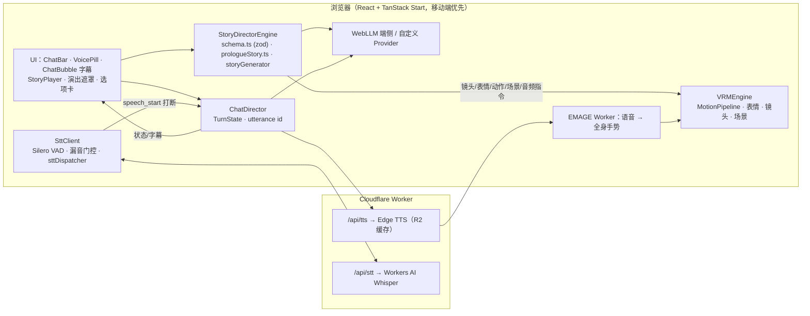

> 📎 **附件 PDF（题目 × 小蠢 功能对照）**
> - [AI 初次审查版 PDF](./ai-initial-review.pdf)：AI 对本分支做的初次只读审计（基线 `main`@`524af1c`，共 106 条：已有 58 / 部分 21 / 无 24 / 说明性 3）。
> - [最终版 PDF](./final-review.pdf)：迭代完成后的最终功能对照（已有 78 / 替代满足 9 / 部分 9 / 无 7 / 说明性 3）。

# 小蠢 (XiaoChun) · 72 小时实时互动场景产品交付文档

> 72 小时实验：实时互动场景产品设计与架构实现交付规范

> 本次交付基于既有开源项目 Project XiaoChun（`main`@`524af1c`，v0.1.39，3D VRM 陪伴角色「小蠢」）迭代：角色、渲染引擎、端侧 AI 链路是已有基础。72 小时内新做的是剧情序章《序章·初遇小蠢》（Act 0，零 Key 的 Mock 演示）、全双工语音打断、镜头与演出、zh / en / ja 三语化，见分支 `feature/interactive-scene-flow` 相对 `main` 的 169 个提交（截至 `355c3ca`）。
> 仓库：<https://github.com/FireTable/project-xiaochun> · 小蠢为原创成年 VRoid 角色。

---

## 1. 快速启动与演示说明

> ⚠️ **体验请使用分支 `feature/interactive-scene-flow`**：本次改动尚未合并到 `main`，正在等待安全审查等评审。

- **演示地址**：<https://xiaochun.firetable.tech/>（备用 <https://project-xiaochun.firetable.workers.dev>）。首次打开自动进入 Act 0，无需 API Key。
- **本地启动步骤**（确保一条命令或 15 分钟内可完成）：
  ```bash
  # 依赖安装与启动命令（Node.js 18+，pnpm）
  git checkout feature/interactive-scene-flow
  pnpm i && pnpm dev            # → https://localhost:5185（自签名证书，HTTPS 便于手机访问时使用麦克风）
  # 可选：cp .env.example .env.local，配置 TTS_PROXY_URL / STT_PROXY_URL 指向已部署的 Worker
  # 部署：pnpm run deploy        # = pnpm build && wrangler deploy（Cloudflare Workers）
  ```
  - 模型从 CDN 按需下载，无需手动准备。
  - 校验：
    - `pnpm vitest run`（63 个文件 / 549 项通过）
    - `npx tsc --noEmit`（0 错误）
    - `pnpm check:i18n`（三语各 822 key 对齐）
    - `pnpm check:cjk`（0 处未国际化字面量）
- **演示录屏 (3–5 分钟)**：
  - 视频链接 / 录屏文件：[Project XiaoChun Demo 4K](https://t.me/project_xiaochun/3) · [Project XiaoChun Demo 2K](https://t.me/project_xiaochun/4)（Telegram 公开频道）
  - 演示内容涵盖项自查：
    - [x] 文字或语音互动
    - [x] 角色状态和画面变化
    - [x] 角色说话时成功打断
    - [x] 所选择的动画、视频或生成媒体能力
    - [x] 至少一种失败或降级状态
  - 说明：Act 0 是脚本化引导，不开放打断；自由对话与语音打断在序章结束后的**聊天模式**中演示。

---

## 2. 系统结构和主要模块

- **架构总览**（架构图 / 数据流图）：



- **主要模块划分与职责**：
  1. **场景与角色视觉渲染模块**：
     - `VRMEngine`（three.js + three-vrm）负责渲染、换装、场景切换（`void` / `light` / `dark` / `beach3d`，海滩带 24 h 昼夜）。
     - 新增 `CameraDirector` 运镜、剧情结束平滑回到默认视角（`viewReturn`），以及离开页面时释放 GPU 上下文、预热分片执行（`6d72180`）。
  2. **语音与音频处理模块 (STT / VAD / 麦克风)**：
     - `src/stt/`。
     - Silero VAD v5 负责分句和检测开口。
     - TTS 播放期间用漏音门控过滤回声。
     - `sttDispatcher` 默认把整句交给云端 Whisper，熔断后回落到本地 SenseVoice。
  3. **交互导播与状态机模块 (待机 / 倾听 / 思考 / 说话)**：
     - `ChatDirector.turnState` 作为唯一状态源，同时驱动姿态、字幕状态和发送 / 停止按钮。
     - 剧情由 `StoryDirectorEngine` 逐拍执行，用执行序号作废过期的异步任务。
  4. **大语言模型与对话逻辑模块**：
     - 聊天走 `generateSpeechReply`，带 IndexedDB 记忆。
     - 剧情中的自由输入交给 `storyGenerator`：LLM 输出 JSON，经 zod 校验，6.5 s 超时后使用兜底拍。
  5. **语音合成与唇形同步模块 (TTS)**：
     - 回复切成 30–60 字的片段并行合成，首片就绪即开始播放。
     - 口型由音量（RMS）驱动，说话时表情让位给口型。
     - 字幕以打字机效果显示，真正出声后才出现。
  6. **角色动作与场景演出驱动模块**：
     - `MotionPipeline` 每帧只有一个写入源（clip > emage > vrma > idle），过渡用五次平滑曲线。
     - `MOTION_CATALOG` 配置 35 个 VRMA 动作。
     - `preserveMotion` 让指定动作在说话时继续播放，播完由 EMAGE 接管。
     - 演出层负责转场、调色、风力，以及程序化 BGM 和音效。

---

## 3. 语音交互与打断流程

- **多轮语音交互流程**：
  - 开麦后 VAD 检测到开口，角色进入**倾听**。
  - 停顿约 1.2 s 后整句转写进输入框 → 发送 → **思考**（LLM 生成回复）→ 切片 TTS → **说话**（音频 + 口型 + EMAGE 手势 + 字幕）→ 回到**待机**，然后可以继续下一轮。
- **语音打断 (Barge-in) 机制**：
  - **检测方案**（自动语音活动检测 VAD / 按住说话或点击打断）及选择该方案的原因：
    - 以自动 VAD 为主，另外提供按住说话和 ■ 停止按钮。
    - VAD 最接近真人对话里"开口就打断"的体验。
    - 它的风险是扬声器回声会造成误打断，所以 TTS 播放期间做了漏音门控（RMS 门限 0.08，加 250 ms 残响冷却），只有越过门限的人声才算打断。
    - 在输入框里打字不会打断角色，点发送才会。
  - **打断发生后的清理与失效逻辑**：
    - 当前语音停止方式：`stopSpeaking()` → `chatDirector.stop()`：递增 utterance id，立即停止音源、口型、EMAGE 和动作播放器，字幕气泡同步收起。
    - 未完成回复及排队任务的取消逻辑：
      - 说话链路里每次 `await` 之后都检查 `owns(id)`，过期的 LLM 结果、TTS 预取和 EMAGE 推理会被直接丢弃。
      - 剧情中则由 `interrupt()` 停掉 TTS、运镜和延迟音效，并停止自动推进。
    - 尚未播放的字幕、动作和媒体事件的拦截：
      - 气泡更新经过 `guardedStatus` 包装，过期的 utterance 改不了气泡。
      - 剧情里的延迟指令受执行序号保护。
    - 页面状态流转（切换到倾听态）：
      - 收到 `speech_start` 后调用 `setListening(true)`，用 0.75 s 过渡到倾听姿态。
      - 并继续转写用户的新话语。
  - **网络迟到响应处理**（防止上一轮迟到响应覆盖当前状态）：用三道令牌拦截：
    - utterance id（LLM / TTS）
    - `currentTurnId`（迟到的转写结果）
    - 动作 race token（迟到加载完成的动作）

---

## 4. 角色和场景指令的设计

- **第一部分：角色「小蠢」**
  - **角色来源**：原创成年角色，由 VRoid Studio 制作。
  - **模型与换装**：
    - VRM 3D 模型（`public/vrm/xiaochun_base.vrmbase`）
    - 9 套换装增量包（`public/vrm/addons/*.vrmaddon`）：`dinner_dress`、`techwear`、`cheongsam`、`bikini`、`maid`、`swimsuit`、`shroud`、`office_lady`、`wedding`
    - 换装入口统一为 `src/lib/outfit.ts`，连点时最新请求优先
  - **表情**：9 种基础情绪（`neutral` / `gentle_smile` / `hesitant` / `shy` / `surprised` / `sad_longing` / `playful` / `happy` / `angry`）+ 4 种微反应（`blush_ramp` / `avert_gaze` / `eye_crinkle` / `sudden_shock`）
  - **动作**：
    - 35 个 VRMA 动捕动作，登记在 `MOTION_CATALOG`
    - 8 个语义动作组：`greeting`、`idleFlavor`、`listening`、`thinking`、`praiseCute`、`playfulSulking`、`dancePerformance`、`outfitShowcase`
    - EMAGE 根据语音生成全身手势
  - **其他表现**：口型、视线、弹簧骨物理；场景有 `void` / `light` / `dark` / `beach3d`；界面与台词支持 zh / en / ja 三语
- **第二部分：指令**
  - **指令协议与实现**（以下为原有内容）：
    - **指令协议格式设计**（JSON / DSL / 结构体定义）：
      - 采用 zod 定义的 JSON 拍子图（`src/story/schema.ts`）。
      - 每一拍包含镜头、演出效果、演员（动作 / 表情 / 三语台词）和音频，并以选项、自由输入或自动跳转结束。
      - 手写剧本和 LLM 生成的拍子共用这套协议。
      - 剧本 linter（`prologueStory.test.ts`）负责校验可达性、三语齐全以及各类 id 是否存在。
      ```ts
      { id: 'beat_2',
        camera: { shot: 'medium_close_up', movement: 'orbit_to_front', durationSec: 2.4 }, waitForCamera: true,
        actor: { leadInMotion: 'angryJump', expression: { base: 'angry', intensity: 0.6, microReaction: 'sudden_shock' },
                 speechText: { 'zh-CN': '哇啊！你什么时候进来的？！…', en: 'Whoa! …', ja: 'わあっ！…' } },
        audio: { bgmMood: 'dusk_warm', sfx: [{ id: 'whoosh' }, { id: 'heartbeat', afterCamera: true }] },
        choices: [{ id: 'lang_en', text: 'Loud and clear!', actionType: 'change_lang', actionPayload: 'en', nextBeatId: 'beat_3' }] }
      ```
    - **具体指令实现与映射清单**：
      - **情绪与表情**（至少 3 种）：共 9 种基础情绪 + 4 种微反应，阻尼平滑过渡。
        1. `angry` + `sudden_shock`：被抓包时恼羞成怒（第 2 拍）
        2. `shy` + `blush_ramp`：请你帮她检查头发（第 3 拍）
        3. `playful` + `eye_crinkle` / `happy`：换装、到达新场景
      - **非说话动作或视觉状态**（至少 2 种）：
        1. 倾听姿态（`listening.vrma` 动捕）、思考姿态、待机时的随机小动作
        2. 剧情动作（`angryJump`、`relaxStretch`、`joyfulJump` 等）
        3. 换装后播放展示动作
      - **背景、镜头或环境变化**（至少 1 次）：
        1. 从虚空 `void` 用白闪转场切到所选场景
        2. 海边的光影从"当前时间 − 12 h"扫到此刻，再跟随真实时间
        3. 运镜包括 `slow_push_in` / `orbit_to_front` / `dutch_tilt`，另有调色和 0–3 档风力
      - **当前对话触发的明显视觉事件**（至少 1 个，非固定定时器触发）：
        1. 用户的选择直接触发：
           - 选语言后台词和语音随之切换
           - 选衣服后当场换装并播放展示动作
           - 选场景后先预览，确认后白闪切换
        2. 剧情中的自由输入由 LLM 生成新的一拍。
  - **SDK（嵌入包 `@firetable/project-xiaochun`）**：
    - 位置：`packages/project-xiaochun/`，说明见 `docs/EMBED.md`
    - 接入方式：无框架 JS SDK `createXiaochun()`、Web Component `<xiaochun-avatar>`、React 的 `<Xiaochun />` / `useXiaochun`、一行 `<script>` loader
    - 通信：宿主页通过懒加载的 `/embed` iframe 与角色通信，使用 `xc.*` postMessage 消息；握手时严格校验 origin，握手后改走 `MessageChannel`
    - 可用指令：`say`、`speakAudio`、`motion`、`expression`、`setOutfit`、`setScene`、`prefetch`、`pause` / `resume` 等
    - 与协议的关系：`xc.say` / `xc.audio` 等消息由 `src/embed/bridge.ts` 转成同一套 action，交给同一个 handler（`src/core/protocol/handler.ts`）
  - **`xiaochun://` 协议**：
    - 作用：系统级 deep link，外部程序、脚本、命令行和 AI agent 可以唤起桌面端小蠢并下达指令；由 Tauri 桌面壳（`src-tauri/src/lib.rs`）解析，再以 `protocol:action` 事件交给 WebView
    - 支持的 action：
      - `speak`：念一段文字（`text`），或播放预合成音频（`audioUrl`），或读取本地文本文件（`file`）
      - `motion`：播放单个动作（`name` 或 `url`，可选 `loop` / `fadeDuration` / `timeScale` / `mask` / `stop`）
      - `motion-group`（别名 `group`）：从动作组里随机播放一个动作
      - `expression`：触发表情（`name`，可选 `intensity`）
      - `camera`：镜头调度（`shot` / `movement` / `durationSec` / `orbitAngleDeg` / `targetFov` / `reset` / `panUp` 等）
      - `stop`：立即停止语音和动作
    - 示例：`xiaochun://speak?text=...`、`xiaochun://motion?name=waving`、`xiaochun://stop`
    - 调用方式：系统命令（`open` / `start` / `xdg-open`）或仓库内置命令（`pnpm speak` / `pnpm motion` / `pnpm expr` / `pnpm camera` / `pnpm stop`），详见 `docs/PROTOCOL.md`

---

## 5. 使用的模型、媒体方案和主要第三方服务

本项目本质上是**端侧模型项目**：没有直接接入在线 LLM，默认在浏览器内运行模型。为了保证演示效果，语音识别接入了在线 ASR 模型，同时保留端侧模型作为兜底。

- **大语言模型 (LLM)**：
  - 端侧 WebLLM（WebGPU，`MiniCPM5-2B-q4f16_1-MLC`）
  - 回退模型 `Qwen2.5-0.5B-Instruct-q4f16_1-MLC`
  - 也可由用户自行接入 OpenAI 兼容服务（Ollama / LM Studio / vLLM 等）
  - Act 0 不调用 LLM
- **语音识别方案 (STT)**：
  - VAD：Silero VAD v5
  - 在线：Cloudflare Workers AI `whisper-large-v3-turbo`（`/api/stt`）
  - 端侧兜底：SenseVoice Small int8 + CT-Transformer 标点（Web Worker）
- **语音合成方案 (TTS)**：
  - 语音：Microsoft Edge TTS 神经语音（`zh-CN-XiaoyiNeural`、`ja-JP-NanamiNeural`）
  - 经自建 Worker 代理，带 R2 缓存
  - 客户端用 Tone.js 做人声处理
- **角色动画 / 视频 / 生成式多模态方案**：
  - VRM 3D 角色 + 35 个 VRMA 动捕动作
  - EMAGE（CVPR 2024，ONNX INT8，端侧 Worker）根据语音生成全身手势
  - 配合表情、口型、视线和弹簧骨物理
  - 未使用视频或生成式图片 / 视频
- **主要开源库、素材来源与第三方服务声明**：
  - 前端库：three.js、@pixiv/three-vrm、@mlc-ai/web-llm、onnxruntime-web、Tone.js、React、TanStack Start、Tailwind、Radix、i18next、zod、jsonrepair
  - 云服务：Cloudflare Workers / Workers AI / R2、Edge TTS（使用公开的 `TRUSTED_CLIENT_TOKEN`）、Hugging Face、自有 CDN
  - 模型与许可：EMAGE（Apache-2.0，已修改，见 `packages/emage-onnx/NOTICE`）
  - 角色与场景素材：角色由 VRoid Studio 制作；`beach3d` 场景用程序化几何 + 2 张贴图
  - 音频：BGM / 音效全部程序化合成
  - VRMA 动作来源：大部分转换自 Adobe 开放动作库（Mixamo），少量从公开仓库搜集，均经 `scripts/slice-vrma.mjs` 精修
  - 密钥声明：仓库不含任何密钥

---

## 6. 关键技术选择与取舍

> 备注：本项目从一开始就定位为端侧小模型项目，依赖浏览器端侧模型，效果上限受制于当前端侧模型能力，很多环节无法做到最好；以下取舍都是在这一前提下尽量做好的选择。

- **选型与权衡 1**：
  - 选择：STT + LLM + TTS 组合链路，流式切片。
  - 放弃的备选方案：端到端实时语音模型。
  - 取舍原因与考量：
    - 每一段都可以单独替换和降级
    - 端侧也能运行，评审无需私人 Key
    - 代价是延迟更高，附和语音只能在声学层面区分
- **选型与权衡 2**：
  - 选择：3D VRM 角色动画（动捕 + EMAGE）。
  - 放弃的备选方案：预渲染 MP4 片段、生成式图片 / 视频。
  - 取舍原因与考量：
    - 能实时响应任意台词、镜头和打断，没有片段数量上限，也没有黑屏或生成等待
    - 视频方案在 72 小时内难以保证"一打断就停"
- **选型与权衡 3**：
  - 选择：声明式拍子图 + zod 校验；Act 0 采用脚本化 Mock 序章。
  - 放弃的备选方案：全部演出由 LLM 实时生成；录制回放模式。
  - 取舍原因与考量：
    - 核心演出在任何环境下都能 100% 复现，也能逐拍测试
    - 代价是聊天模式还没有接入这套协议

---

## 7. 已知问题与局限

- **当前尚未完成的能力及当前状态**：
  - 未做视频 / 生成式媒体
    - 已有的替代方案：多模态表现选择了 3D 角色动画（VRM + 35 个 VRMA + EMAGE 手势 + 表情口型）
    - 剧情拍用遮幅（letterbox）电影模式驱动同一个常驻 3D 角色，结束后镜头平滑回到默认视角
    - 同一个 VRM 模型保持外观一致，换装会持久化，海滩光影随时间连续变化
    - 聊天中 LLM 生成回复期间播放思考动作；剧情生成新拍时禁用输入，生成出的剧情拍经 jsonrepair + zod 校验，解析失败或超时改用兜底拍
  - 聊天模式的回复不走导演协议
    - 已有的替代方案：剧情中的自由输入由 `storyGenerator` 让 LLM 输出符合导演协议的拍子（zod 校验）
    - 普通聊天仍是文本 + EMAGE 手势
  - 语音转写后需手动发送
    - 已有：VAD 自动分句，云端 Whisper（熔断后本地 SenseVoice）转写，并自动填入输入框
  - 剧情引导（第 0 幕）没有开放打断
    - 这是端侧项目：第 0 幕播放时 WebLLM 还未就绪，为了用户体验特意不开启
    - 打断能力在聊天模式中已实现，演示录屏在序章结束后的聊天模式中展示
  - 附和语音（"嗯""对"）没有语义级判断
    - 已有：TTS 播放期间用 RMS 门限（`bargeInRms` 0.08）加 Silero VAD 置信度过滤回声，只有越过门限的人声才算打断
    - 转写结果中只有语气词的会被过滤掉
  - 没有录制回放和面向用户的延迟观测页（只有开发抽屉）
    - 已有（仅开发抽屉）：语音分析卡片显示识别耗时 / 时长 / RMS，并保留最近 10 条语音的 WAV 与识别结果，另有动作面板
    - 已有：`ChatDirector` 的 `TurnState` 变更事件和剧情 history 可用于排查问题
- **遇到的主要问题与技术挑战**：
  - 扬声器回声导致角色打断自己（`d8079e4`）
  - 迟到的异步结果造成僵尸气泡、幽灵文本、按钮状态错乱（`e05dd36`、`ac5493a`、`8de22d7`）
  - 动捕循环接缝让裙摆弹簧骨炸开（用切片脚本修复）
  - 剧情结束后镜头跳一帧（`e687bd4`）
  - 移动端 GPU 资源占用（`6d72180`）
- **异常、超时与降级兜底方案**：
  - TTS 失败时只显示字幕，剧情按字数停留后继续推进
  - 在线 ASR 连续 2 次失败熔断 5 分钟，期间切到端侧模型
  - 剧情 LLM 6.5 s 超时后使用兜底拍
  - LLM 出错时气泡给出提示并回到待机
  - 模型未就绪时输入先排队，不丢字
  - 浏览器拦截自动播放时，在"轻触推门"这一次点击里解锁音频

---

## 8. 大致投入时间

- **大致时间分配**（72 小时窗口期内）：2026-10-26（周一）12:00 收到题目。按本分支提交的作者时间（北京时间）统计，计算方法：**每日有效时长 = 当日首末提交跨度 − 跨度内的凌晨睡眠 8 h − 每日休息 2 h**。

  | 日期 | 首个提交 | 最后提交 | 跨度 | 扣除 | 有效 |
  | :-- | :-- | :-- | --: | :-- | --: |
  | 10-26 | 13:13 | 23:09 | 9.9 h | 休息 2 h | 7.9 h |
  | 10-27 | 01:52 | 22:38 | 20.8 h | 睡眠 8 h + 休息 2 h | 10.8 h |
  | 10-28 | 00:32 | 23:45 | 23.2 h | 睡眠 8 h + 休息 2 h | 13.2 h |
  | 10-29 | 00:01 | 05:34 | 5.6 h | 休息 2 h | 3.6 h |

  - 需求分析与方案设计：含在上表内（读题和方案设计主要集中在 10-26）
  - 核心流程开发：含在上表内
  - 动作/多模态与交互打磨：含在上表内
  - 降级机制与调试测试：含在上表内
  - 交付录屏与文档编写：含在上表内（主要在 10-29）
  - **总计投入人时**：约 35.5 小时（156 个提交，截至 `2a33aa6`）。主要工作是在既有小蠢基础上做更好的内容呈现与交互。

---

## 9. 如果继续开发两周的演进规划

> 题目要求的基础能力基本都有了，下一步最值得投入的是动作管线，这也是小蠢和同类产品的差异点。市面上多数产品只做上半身；我们做的是全身 3D 角色，目标是从任何机位看都站得住、动得自然。

- **第 1 周目标与计划**：
  - **动作管线**：
    - 脚部 IK（`footIK.ts`）目前只在 EMAGE 说话时求解，计划扩展到所有动作、待机、思考和倾听，并按场景地形采样地面高度，做到在任何地面上都不滑步、不悬空
    - EMAGE 手势和自定义动作期间站姿自适应
    - 把动作之间的切换整理成明确的过渡表
    - 扩展 `slice-vrma.mjs --scan`，量化滑步、穿地和接缝
    - 验证方式：单元测试阈值 + 正面 / 侧面 / 背面 / 低机位多机位录屏对比
  - **全身多角度**：针对侧面、背面和低机位，专门调下半身、重心转移和裙摆 / 头发的二级运动。
- **第 2 周目标与计划**：
  - **合并剧情模式与聊天模式**：聊天回复也走导演协议（表情 / 动作 / 镜头指令），剧情和自由对话无缝衔接。
  - **合入动作生成实验分支**：目前还在本地实验，计划合入主线。
  - **训练路线**：例如为小蠢训练专属的 LoRA 风格包。
- **长期技术与产品愿景**：记忆库这类通用需求优先级较低。项目已经支持 `xiaochun://` 协议和 `/embed` 嵌入，可以放进任何地方，由更好的 harness agent 驱动，所以这部分暂时没有大力更新。我们会把精力集中在角色表现力本身。

---

## 附录：迭代里程碑（相对 main）

> 统计范围：`git log main..HEAD`，共 169 个提交（截至 `355c3ca`，不含本附录的文档提交），时间为 2026-10-26 13:13 至 10-29 11:44（北京时间）。下表按时间顺序归并为 17 个里程碑，每行只列代表提交，完整列表见 `git log main..HEAD`。

| 里程碑 | 主要内容 | 作用 / 目的 | 代表提交 |
| :-- | :-- | :-- | :-- |
| 1. 全双工语音打断与倾听态<br>（10-26） | 说话时可被打断；倾听姿态；去掉阻塞式加载转圈；`TurnState` 作为唯一状态源；过渡时长自适应（0.75–1.0 s） | 满足"角色说话时成功打断"，并避免按钮状态与真实状态不一致 | `3b55161` `e05dd36` `abe8509` `a103b9e` `a2cd460` |
| 2. 统一动作目录与 VRMA 精修起步<br>（10-26） | `MOTION_CATALOG`、`timeRange` 子片段、`antiClip` 解耦；倾听动作无缝循环、骨盆接地 | 动作配置化，便于扩充；解决动捕滑步、悬空和循环接缝 | `91ee0b2` `4549268` `0135112` `90fcf30` |
| 3. 胸部与衣物贴合物理<br>（10-26 至 10-28） | 手臂碰撞体接入胸部弹簧骨；缩放后的胸部不穿出衣服；手臂顶点推出胸前椭球；后期改为依赖 GPU 蒙皮，并调胸部弹簧骨参数 | 动作和换装时不穿模（含一次回退 `511174e` 后重做） | `3a339da` `228b638` `9abf189` `d7d91b4` `494a9a4` `4ac26c6` |
| 4. beach3d 24 小时昼夜<br>（10-27 至 10-29） | 太阳 / 月亮轨迹与三套时段调色；`SceneTimeCard` 24 小时面板；道具与角色影子统一；修复夜间海平线虚线；剧情中从"现在 − 12 h"扫到现在 | 场景随时间连续变化，满足"背景或环境变化" | `8824215` `514b8a6` `5baeb85` `3cebc18` `177a656` `9b07ac4` |
| 5. 动作管线与躯干修正<br>（10-27） | 下半身 locomotion 状态机；VRMA 切片工具 `--zero-z` / `--scan`；27 个标准化动作与别名解析；躯干 / 大腿矩阵解耦；换装时的过期 VRM 指针与过渡跳变 | 动作播放稳定、不滑步、不穿地，切换自然 | `11dc4b8` `b672b46` `5ea26a4` `00d4922` `57c74a4` `1f217df` `59b6774` |
| 6. 剧情导演引擎与序章首版<br>（10-27） | `StoryDirectorEngine`、`CameraDirector`、遮幅与选项卡、回顾记录、换装展示流程；序章围绕 AI 伙伴校准重写 | 提供可脚本化、可逐拍测试的互动场景（Act 0） | `06df461` `5d408a3` `a44a17e` `4f7006e` `29ad2a0` `8b0987d` |
| 7. 云端 TTS 与独立 Worker<br>（10-27） | Sec-MS-GEC v2；可选 R2 持久缓存和韵律参数矩阵；独立 `xiaochun-tts` Worker 与 `deploy:tts`；MP3 / Opus / OGG 对比文档 | 语音合成稳定、可缓存、可单独部署 | `c5581b4` `75b2a74` `44116b3` `fdaaa0e` |
| 8. 动作组、待机调度与资产缓存<br>（10-28） | 情境动作组与待机微动作调度、迎客动作；`MotionAssetManager` 两级缓存；播放竞态令牌；未驱动骨骼隔离；腿部外八修复；思考姿态并入 `playMotion` | 动作可按场景随机组合；降低加载延迟；避免切换时姿态串扰 | `a1c1a2e` `7a5c935` `8de22d7` `d10147f` `793cde6` `2ce52b5` |
| 9. 语音链路（VAD / STT）<br>（10-28） | Silero VAD v5；两段式标点恢复；漏音门控与打断保护；迟到转写防复活；Cloudflare Workers AI Whisper 与自定义 Provider；混合 2-pass，最终默认纯云端 | 打断可靠、转写质量高，云端失败时可回落本地 | `8bb6c88` `84ec335` `d8079e4` `ac5493a` `f05aca9` `878714c` `c12527b` |
| 10. 字幕气泡与对话界面<br>（10-28） | GPU 合成打字机字幕；`HeadBubble` 统一并改名 `ChatBubble`；折叠展开保留状态；选项卡布局；输入法组合保护 | 对话以角色和字幕为主体，不使用聊天消息列表 | `4e9971e` `7199b7d` `01a5f90` `6de9fbe` `c7331b6` `6a986b7` |
| 11. 表情系统<br>（10-28） | `setExpression` 接入 `ExpressionController` 阻尼；动作内置表情与说话让位；表情更生动并随头部俯仰同步；困倦眼睑 | 表情与动作、说话协同，更自然 | `fbec372` `ae8bcef` `4010ba8` `ee3c32d` |
| 12. 外部协议、SDK 与镜头<br>（10-28） | `xiaochun://` 扩展 motion / group / expression / camera；`window.xiaochun` 控制台入口；`group` 改名 `motion-group` 并兼容旧名；风力、倾斜镜头、背光揭示；镜头运动不触发转身；全身取景校准 | 让外部程序、脚本和 agent 可以驱动角色与镜头 | `c5f48aa` `e98ba3b` `a812d1a` `41fa5c0` `cbca08b` `ef3251f` |
| 13. 剧情数据协议与导演音频<br>（10-28） | 三语台词、转场、调色和导演字段；程序化 BGM / 环境音 / 音效；`autoNext` 与三语播放；第二版 Act 0（13 拍） | 剧情演出由声明式数据驱动，零外部音频资源 | `ea7584c` `6f036d6` `9de8c0f` `b3c99b4` `db07513` `9d9697d` |
| 14. Act 0 多版迭代与定稿<br>（10-29） | 后台抓包、从虚空场景开场、固定暗号卡片、选大脑、换装 / 场景预览与"当前"徽标、换装持久化、改名《初遇小蠢》；镜头编排与 `waitForCamera`；结束后视角回位 | 形成可在零 Key 下完整演示的序章 | `8458424` `16ab04f` `f78fb8d` `2bbab2e` `0b37bf3` `c46ebb2` `f6ab0b9` `e687bd4` |
| 15. 动作保留与 EMAGE 接力<br>（10-29） | `preserveMotion`；手指 0.34 s 微淡入；剧情拍的引导动作说话时不被打断；管线配置集中到 `APP_CONFIG` | 剧情动作完整播放并自然接上说话手势，普通聊天不受影响 | `7aab7f0` `f49b459` `2d71fa2` |
| 16. 交付文档、构建与性能<br>（10-29） | 新增交付文档目录，填写 README 与 AI_USAGE；VAD 静音门控优化；页面离开时释放 GPU 上下文并分片预热；构建后退出钩子；序章换装与镜头收尾 | 满足交付要求，并提高移动端稳定性 | `9d28afb` `8867760` `9068949` `9db9cfd` `439a39b` `6d72180` `2a33aa6` `0ce2e1c` |
| 17. 安全审查加固与来源白名单<br>（10-29） | TTS / STT 入参校验与请求体上限、IndexedDB 容错、动作缓存校验；`/api/tts` 与 `/api/stt` 的 Origin 白名单（含 Tauri 桌面来源）；文档结构化；气泡进度标签去掉绿点 | 降低滥用与异常输入风险，同时保证站内与桌面端请求可用 | `1f85ad8` `889fd73` `fb46c46` `8d9bbe5` `0a630e9` `355c3ca` |
