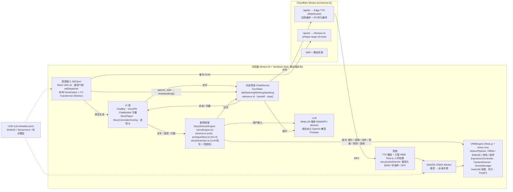

# 小蠢 (XiaoChun) · 72 小时实时互动场景产品交付文档

> 72 小时实验：实时互动场景产品设计与架构实现交付规范

> **本次交付的定位**：在既有开源项目 Project XiaoChun（`main`@`524af1c`，v0.1.39，3D VRM 陪伴角色「小蠢」）之上，于 72 小时窗口内在分支 `feature/interactive-scene-flow` 上做出题目要求的「实时互动场景」：一段可零 Key 体验的剧情序章《序章·初遇小蠢》（Act 0）+ 支持全双工语音打断的自由聊天。角色、渲染引擎、端侧 AI 链路是赛前已有的基础；本文「我们做了什么」以该分支相对 `main` 的 154 个提交（`main..HEAD`，HEAD `2d71fa2`）为准。
>
> - 源码仓库：<https://github.com/FireTable/project-xiaochun>（取自本地 `git remote`）· 分支：`feature/interactive-scene-flow`（TODO：确认已推送到远端，或已合并到 `main`）
> - 角色设定：小蠢为原创 VRoid 角色。TODO：请确认并写明「成年」设定（当前人设提示词 `src/llm/prompts.ts` 未写年龄）。

---

## 1. 快速启动与演示说明

- **演示地址**：<https://xiaochun.firetable.tech/>（备用：<https://project-xiaochun.firetable.workers.dev>）。首次打开会自动进入《序章·初遇小蠢》（Act 0），无需任何 API Key；看完后会记住已看过，想重看需清除站点数据（开发抽屉里也有重放入口）。
- **本地启动步骤**（确保一条命令或 15 分钟内可完成）：
  ```bash
  # 依赖安装与启动命令（需要 Node.js 18+ 与 pnpm；preinstall 钩子强制使用 pnpm）
  pnpm i && pnpm dev
  # → https://localhost:5185   （dev 使用 @vitejs/plugin-basic-ssl 自签名证书，浏览器需手动信任一次；
  #                               HTTPS 是麦克风 getUserMedia 在局域网设备上可用的前提）

  # 可选：本地配置（不配置也能跑；.env.local 已被 git 忽略）
  cp .env.example .env.local    # TTS_PROXY_URL / STT_PROXY_URL：把本地 /api/tts、/api/stt 转发到已部署的 Worker

  # 生产构建与部署（Cloudflare Workers）
  pnpm run deploy               # = pnpm build && wrangler deploy
  ```
  - 角色模型、动作随仓库（`public/`）；EMAGE / SenseVoice / 标点模型从 CDN 按需下载，不需要手动准备。
  - 本地 dev 下 `/api/tts`、`/api/stt` 由 `vite/localApiPlugin.ts` 提供：TTS 可直连 Edge TTS；云端 STT 需 `STT_PROXY_URL` 指向已部署 Worker，否则自动熔断回落到浏览器端 SenseVoice。
  - 校验命令：`pnpm vitest run`（2026-10-29 实测 63 个测试文件 / 549 项全部通过）、`npx tsc --noEmit`（0 错误）、`pnpm check:i18n`（zh-CN / en / ja 各 822 个 key，完全对齐）、`pnpm check:cjk`（src 中 0 处未走 i18n 的界面字面量）。
  - 干净环境（全新 clone）的完整启动耗时未实测，TODO。
- **演示录屏 (3–5 分钟)**：
  - 视频链接 / 录屏文件：[Project XiaoChun Demo 4K](https://t.me/project_xiaochun/3) · [Project XiaoChun Demo 2K](https://t.me/project_xiaochun/4)（Telegram 公开频道）
  - 演示内容涵盖项自查：
    - [ ] 文字或语音互动 —— 自由聊天模式：文字输入 + 麦克风（Silero VAD 自动检测开口）
    - [ ] 角色状态和画面变化 —— 待机 / 倾听 / 思考 / 说话四态；Act 0 的运镜、转场、调色、换场景、换装、海边昼夜扫时
    - [ ] 角色说话时成功打断 —— 自由聊天模式（及补充视频）：小蠢说话时开口，语音立刻停止并切到倾听
    - [ ] 所选择的动画、视频或生成媒体能力 —— 3D VRM 角色动画：35 个 VRMA 动捕动作 + EMAGE 音频驱动全身手势 + 表情 / 口型
    - [ ] 至少一种失败或降级状态 —— 例如 TTS 失败时只显示字幕（`ttsUnavailable`）、云端 STT 熔断回落本地、剧情生成超时用兜底拍
    （TODO：请对照成片勾选，并可补上各项在视频中的时间点）
  - 录屏演播辅助工具：`chalkboard.html`（快捷键：`H` 隐藏界面，`空格` 一键全流程演播）

---

## 2. 系统结构和主要模块

- **架构总览**（架构图 / 数据流图）：



- **主要模块划分与职责**：
  1. **场景与角色视觉渲染模块**：`src/core/vrmEngine.ts`（three.js + `@pixiv/three-vrm`）统一调度渲染循环、换装（`.vrmaddon` 增量包）、场景（`light` / `dark` / `beach3d` / `void`，`sceneManager`）。`beach3d` 为程序化海滩，带 24 小时太阳轨迹与 `SceneTimeCard` 昼夜面板（`docs/BEACH3D_SCENE.md`）。本次新增：`CameraDirector` 景别与运镜（`slow_push_in`、`orbit_to_front`、`dutch_tilt`、`hero_backlight_reveal`、`hero_spiral_orbit` 等）；剧情结束时用 `viewReturn` 把镜头缓动回默认视角，并逐帧跟随实时默认视角，避免收尾跳一下（`dd6f69c`、`e687bd4`）；GPU 资源治理：`pagehide`（非 bfcache）时释放 WebGL 上下文，预热按 8 ms 时间片切分，不卡主线程（`6d72180`，`src/core/gpuRelease.ts`、`gpuPrewarm.ts`）。
  2. **语音与音频处理模块 (STT / VAD / 麦克风)**：`src/stt/`。`SttClient` 在主线程做 Silero VAD v5 分句，静音帧跳过 ONNX 推理（`439a39b`）。TTS 播放期间做声学漏音门控（RMS < `bargeInRms` 0.08 视为回声，另有 250 ms 残响冷却），越过门限的人声才算打断。`sttDispatcher` 默认把整句送云端 Whisper（`/api/stt`，`direct` 策略），失败 2 次熔断 5 分钟、半开探针自愈，期间秒切浏览器端 SenseVoice int8 + CT-Transformer 标点；也可选 `2pass`（本地草稿 + 云端定稿）或纯本地。UI 侧有 `VoicePill` 波形与按住说话、IME 合成保护、`currentTurnId` 防幽灵文本（`docs/STT.md`）。
  3. **交互导播与状态机模块 (待机 / 倾听 / 思考 / 说话)**：`ChatDirector.turnState` 是唯一状态源（`idle | listening | thinking | speaking`），通过 `onTurnStateChange` 驱动动作管线（倾听姿态 `listening.vrma` 动捕、思考 `thinking.vrma`、说话 EMAGE）、字幕气泡状态条与 ChatBar 按钮（发送 / ■停止）。剧情模式由 `StoryDirectorEngine` 驱动节拍生命周期：每个 `await` 都用执行序号校验，进入下一拍或 `finish()` 时自动作废上一拍的残留异步（`docs/STORY_DIRECTOR.md`）。
  4. **大语言模型与对话逻辑模块**：默认端侧 WebLLM（WebGPU + Worker，`MiniCPM5-2B-q4f16_1-MLC`，回退 `Qwen2.5-0.5B-Instruct-q4f16_1-MLC`），无需 Key；也可接任意 OpenAI 兼容服务（Ollama / LM Studio / vLLM / Groq / MiniMax / OpenAI 等，`src/llm/customProvider/`）。自由聊天走 `generateSpeechReply`，带 IndexedDB 多层记忆。剧情模式下用户自由输入交给 `storyGenerator`：导演提示词让 LLM 输出 JSON，经 `jsonrepair` + zod 校验成一个拍子，保留最近 12 条剧情历史；6.5 s 超时或解析失败时生成本地兜底拍（`createFallbackBeat`）。
  5. **语音合成与唇形同步模块 (TTS)**：`/api/tts` 是自写的 Edge TTS WebSocket 代理，带单飞、重试、边缘缓存与 R2 持久缓存（`docs/TTS.md`）。语音按台词文字自动选择（假名 → 日语 `ja-JP-NanamiNeural`，其余默认 `zh-CN-XiaoyiNeural`，见 `APP_CONFIG.tts.voices`）；可换自定义 TTS Provider（含 MiniMax `speech-01-turbo` 模板）。`ChatDirector` 把回复按 30–60 字切片、并行预取，首片就绪即起播；用 RMS 驱动口型，说话时表情自动给口型让位（`speechMouthDucking`）。字幕在 `ChatBubble` 中以打字机方式同步出现，且只在真正出声后才显示（`c7331b6`）。
  6. **角色动作与场景演出驱动模块**：`MotionPipeline` 每帧只允许一个写入源（clip > emage > vrma > idle），统一用五次平滑曲线交叉淡入淡出（自适应 0.75–1.0 s；手指单独 0.34 s 微淡入，`f49b459`）。`MOTION_CATALOG` 配置化管理 35 个 VRMA 动作（分组、绑定表情、预热，`MotionAssetManager`）；`preserveMotion` 让剧情指定的动作在说话时继续播放，播完由 EMAGE 无缝接管（`7aab7f0`、`2d71fa2`）。剧情演出层另有 `StoryCinematicOverlay`（遮幅、转场、调色、黑幕字幕）、`storyAudioDirector`（Tone.js 程序化 BGM / 环境声 / 音效，说话时自动压低 BGM）和风力控制（`windForce.ts`）。

> 国际化：界面与剧情均支持 zh-CN / en / ja。三份语言包各 822 个 key（`pnpm check:i18n` 校验完全对齐）；`scripts/check-cjk-literals.mjs`（`pnpm check:cjk`）保证 `src/` 里没有绕过 i18n 的中日文 / 英文界面字面量。

---

## 3. 语音交互与打断流程

- **多轮语音交互流程**：
  1. 点麦克风（或按住 `VoicePill`）→ `SttClient` 开始采集 16 kHz PCM，Silero VAD 判定开口 → 角色进入 **倾听** 态（倾听动捕姿态 + 92% 注视用户 + 波形）。
  2. 用户停顿约 1.2 s 或松开 → 整句 PCM 送 `/api/stt`（Whisper Turbo）；失败或熔断则本地 SenseVoice 转写 → 文字原位写入输入框（可修改）。
  3. 发送（Enter / 发送键）→ `ChatDirector.say()`：`handoff()` 抢占上一句 → **思考** 态（thinking 姿态 + 气泡）→ LLM 生成回复。
  4. 回复切片 → 并行请求 TTS → 首片就绪起播 → **说话** 态（音频 + 口型 + EMAGE 全身手势 + 打字机字幕）。
  5. 说完回到 **待机**（NaturalIdle + 待机风味动作），对话写入记忆，可继续下一轮。
- **语音打断 (Barge-in) 机制**：
  - **检测方案**（自动语音活动检测 VAD / 按住说话或点击打断）及选择该方案的原因：三种方式都提供。① **自动 VAD 打断（主路径）**：Silero VAD v5 判定开口即发 `speech_start`，`ChatBar` 立刻 `vrmEngine.stopSpeaking()` + `setListening(true)`。② **按住说话**（`VoicePill`）。③ **点击打断**：角色忙时发送键变成 ■ 停止；有草稿时点发送等于"打断并发送"。选 VAD 的原因：题目强调"角色说话时开口即打断"，VAD 最接近真人对话，手机上也不用一直按住。代价是扬声器回声会触发误打断，所以加了 TTS 播放期的声学漏音门控（RMS 门限 0.08 + 250 ms 残响冷却 + 浏览器 AEC）。按钮打断留作嘈杂环境和不愿开麦用户的兜底。打字聚焦输入框**不会**打断角色，只有点发送才会（避免用户刚想打字，角色就被掐断）。
  - **打断发生后的清理与失效逻辑**：
    - 当前语音停止方式：`vrmEngine.stopSpeaking()` → `chatDirector.stop()`：`utterance++`，`hardStop()` 立即停止 `AudioBufferSourceNode`，清零口型 `aa/ou`，停止 EMAGE 流与动作播放器，`turnState` 置 `idle`；同时 `bubbleTracker.hide()` 收起气泡。显式 stop 不做淡出（新一句抢占旧一句时才做 0.4 s 淡出）。
    - 未完成回复及排队任务的取消逻辑：说话链路的每个 `await` 后都检查 `owns(utteranceId)`，被抢占的 LLM 回调、TTS 预取切片和 EMAGE 推理在返回后直接丢弃，不再进入播放队列。剧情模式下 `StoryDirectorEngine.interrupt()` 会停止 TTS、镜头补间和延迟音效，并**停止自动推进**；剧情生成请求由 `AbortController` 控制（6.5 s 超时）。
    - 尚未播放的字幕、动作和媒体事件的拦截：气泡状态更新经 `guardedStatus` 包装，失效的 utterance 不能再改气泡（防"僵尸气泡"）；剧情拍内的延迟 SFX、补间与后续指令都受执行序号保护，序号变化即作废。
    - 页面状态流转（切换到倾听态）：`speech_start` 后 `setListening(true)`，倾听姿态以 0.75 s 五次平滑曲线过渡，用户的新话语继续被转写进输入框。
  - **网络迟到响应处理**（防止上一轮迟到响应覆盖当前状态）：三道纪元 / 令牌：① `ChatDirector` utterance id（迟到的 LLM / TTS 结果 `!owns(id)` 直接 return）；② `SttClient.currentTurnId`（发送或重置后，迟到的 ASR / 标点结果丢弃，防止旧语音文字"复活"进输入框）；③ 动作管线 play race token（`8de22d7`，迟到加载完的动作不会覆盖当前动作）。`TurnState` 是唯一状态源，按钮与姿态不会和真实状态不同步（`e05dd36`）。
  - **演示说明**：Act 0 序章是脚本化的引导剧情，不开放打断。自由对话与打断在序章结束后的**聊天模式**中演示（另有补充视频）。

---

## 4. 角色和场景指令的设计

- **指令协议格式设计**（JSON / DSL / 结构体定义）：用 zod 定义的结构化 JSON（`src/story/schema.ts`）。一个剧本（`StoryScript`）是由**拍（beat）**组成的图，每拍描述一次完整的"舞台调度"：镜头、演出效果、演员（动作 / 表情 / 台词）、音频，然后给出选项、自由输入或自动跳转。手写剧本（Act 0）和 LLM 生成的拍子共用这一协议：LLM 输出经 `jsonrepair` + zod 校验后，由 `StoryDirectorEngine` 执行。示例（Act 0 第 2 拍，节选）：
  ```ts
  {
    id: 'beat_2',
    cinematics: { letterbox: false, grading: 'default', wind: 0 },          // 演出效果：遮幅 / 调色 / 风 / 转场 / 黑幕字幕 / 昼夜
    camera: { shot: 'medium_close_up', movement: 'orbit_to_front', durationSec: 2.4 },
    waitForCamera: true,                                                     // 镜头转到正面后才开演
    actor: {
      leadInMotion: 'angryJump',                                             // MOTION_CATALOG id
      expression: { base: 'angry', intensity: 0.6, microReaction: 'sudden_shock' },
      speechText: { 'zh-CN': '哇啊！你什么时候进来的？！…', en: 'Whoa! …', ja: 'わあっ！…' },
    },
    audio: { bgmAction: 'play', bgmMood: 'dusk_warm', sfx: [{ id: 'whoosh' }, { id: 'heartbeat', afterCamera: true }] },
    choices: [ { id: 'lang_en', text: 'Loud and clear!', actionType: 'change_lang', actionPayload: 'en', nextBeatId: 'beat_3' }, … ],
  }
  ```
  流程控制字段：`choices[].actionType`（`next_beat` / `change_scene` / `swap_outfit` / `change_lang` / `open_provider_config` / `finish` / `custom`）、`branch` + `variants`（分支改写后续拍）、`autoNextBeatId`、`autoFinish`、`allowInput`、`interaction: 'camera_drag'`、`cinematics.timeOfDay`。同一套能力也通过 `window.xiaochun` / 协议（`docs/PROTOCOL.md`）暴露给外部：`motion`、`motion-group`、`expr`、`camera`、`stop`。剧本 linter `src/story/__tests__/prologueStory.test.ts` 会检查 zod 合法性、无死路 / 悬空 id / 不可达拍、三语齐全、台词长度，以及所有动作 / 音效 / 景别 / 转场 id 都真实存在。
- **具体指令实现与映射清单**：
  - **情绪与表情**（至少 3 种）：`expression.base` 共 9 种基础情绪（`neutral` / `gentle_smile` / `hesitant` / `shy` / `surprised` / `sad_longing` / `playful` / `happy` / `angry`），带强度和 4 种微反应（`blush_ramp` 脸红、`avert_gaze` 避开视线、`eye_crinkle` 眯眼笑、`sudden_shock` 一怔），由 `ExpressionController` 阻尼平滑过渡。Act 0 用到：
    1. `angry` + `sudden_shock`：第 2 拍被抓包，恼羞成怒（配 `angryJump` 跺脚）
    2. `shy` + `blush_ramp`：第 3 拍让你帮忙检查头发
    3. `playful` + `eye_crinkle` / `happy`：第 3.5 拍换装、第 5 拍到达新场景
  - **非说话动作或视觉状态**（至少 2 种）：
    1. 倾听态：`listening.vrma` 动捕姿态 + 点头节奏 + 92% 注视；思考态：`thinking.vrma`；待机：NaturalIdle + 待机风味调度
    2. 剧情动作：`singleHandWave`（背对镜头排练）、`pokeFingers`、`fingerObserve`、`gazeObserve`、`relaxStretch`、`joyfulJump`；换装时随机播放 `outfitShowcase` 动作组展示新衣服
  - **背景、镜头或环境变化**（至少 1 次）：
    1. 场景：开场在 `void`（虚空），第 4 拍选择去海边 `beach3d` / 白天线稿 `light` / 夜晚线稿 `dark`，第 5 拍在 `white_flash` 白闪掩护下切换；海边分支的 `timeOfDay: { toNow: true }` 从"浏览器当前时间 − 12 h"一路扫到此刻，再切到 `auto` 跟随真实时间（`9b07ac4`）。镜头：`slow_push_in`（远处斜后方 6.5 m 缓推）、`orbit_to_front`、`dutch_tilt`、`hero_spiral_orbit`；调色 `dream_bloom` / `rainy_noir` / `sepia_memory`；风力 0–3 档。
  - **当前对话触发的明显视觉事件**（至少 1 个，非固定定时器触发）：
    1. 由用户选择直接触发：选语言卡 → 下一拍起换成该语言的台词和语音；点衣服卡 → 当场换装并播放展示动作（持久化到 `WEARING_OUTFIT_KEY`）；点场景卡 → 当场预览场景，确认后白闪切换并开始昼夜扫时。剧情中开放自由输入时，用户的话交给 `storyGenerator` 生成新拍（镜头 + 表情 + 动作）；被打断时生成 `surprised` + `sudden_shock` / `avert_gaze` 的反应拍。所有事件都由当前拍和用户输入驱动，不是固定计时器。

---

## 5. 使用的模型、媒体方案和主要第三方服务

- **大语言模型 (LLM)**：默认端侧 WebLLM（`@mlc-ai/web-llm`，WebGPU，`MiniCPM5-2B-q4f16_1-MLC`，回退 `Qwen2.5-0.5B-Instruct-q4f16_1-MLC`，模型从 Hugging Face 下载）；可选任意 OpenAI 兼容服务（Ollama、LM Studio、vLLM、Groq、MiniMax、OpenAI 等）。Act 0 序章本身是脚本化的，不调用 LLM。
- **语音识别方案 (STT)**：Silero VAD v5（`onnxruntime-web`）分句与打断检测；云端 Cloudflare Workers AI `@cf/openai/whisper-large-v3-turbo`（`/api/stt`，默认 `direct` 策略）；本地兜底 SenseVoice Small int8 + CT-Transformer 标点（Web Worker，模型放在 `cdn.firetable.tech`）；也可配置 OpenAI 兼容 STT（如 MiniMax、Groq Whisper）。
- **语音合成方案 (TTS)**：Microsoft Edge TTS 神经语音（`zh-CN-XiaoyiNeural`、`ja-JP-NanamiNeural`），经自建 Cloudflare Worker `/api/tts` 代理，带边缘缓存 + R2（`xiaochun-tts`）缓存；客户端用 Tone.js 做人声处理与 3D 距离衰减。可选自定义 TTS Provider（含 MiniMax `speech-01-turbo` 模板）。
- **角色动画 / 视频 / 生成式多模态方案**：选择「其他角色动画」：VRM 3D 角色（`@pixiv/three-vrm`）+ 35 个 VRMA 动捕动作 + EMAGE（PantoMatrix，CVPR 2024，ONNX 精简 + INT8，浏览器 Worker 推理）由语音音频生成全身手势 + 表情 / 口型 / 视线 / 弹簧骨物理。未做视频片段和生成式图片 / 视频（见 §7）。
- **主要开源库、素材来源与第三方服务声明**：
  - 开源库：three.js、@pixiv/three-vrm（及 animation / springbone）、@mlc-ai/web-llm、onnxruntime-web、Tone.js、React 19、TanStack Start / Router、Tailwind CSS、Radix UI、i18next、zod、jsonrepair、mpg123-decoder、Vitest、Wrangler。
  - 第三方服务：Cloudflare Workers / Workers AI / R2（部署与 STT、TTS 缓存）、Microsoft Edge TTS（公开共享 `TRUSTED_CLIENT_TOKEN`，不是私人凭证）、Hugging Face（WebLLM 模型）、自有 CDN `cdn.firetable.tech`（EMAGE / STT 模型）。
  - 模型与权重：EMAGE（Apache-2.0，按模型卡；本项目做了 ONNX 导出、裁层与量化，见 `packages/emage-onnx/NOTICE`）、Silero VAD、SenseVoice、CT-Transformer 标点模型、MiniCPM / Qwen（WebLLM 版）。
  - 素材：角色与服装由 VRoid Studio 制作（VRoid Studio License）；`beach3d` 场景几何全部由代码程序化生成，另用两张贴图 `public/scene/beach3d/clouds.webp`、`palm-frond.webp`（TODO：请确认来源，`docs/BEACH3D_SCENE.md` 中称为"手绘风格贴图"，若为 AI 生成请注明工具）；BGM / 环境声 / 音效全部由 Tone.js / WebAudio 程序化合成，仓库不含音频文件。VRMA 动作：部分由 MiniMax 协助从公开仓库搜集，再用 `scripts/slice-vrma.mjs` 切片修整。来源与许可：TODO（逐个补齐 35 个动作的来源仓库与许可证；README 已记录 `thinking.vrma` 许可证未知）。
  - 仓库不含 API Key：`.env.local` 被 git 忽略，`.env.example` 只有模板项。

---

## 6. 关键技术选择与取舍

- **选型与权衡 1**：
  - 选择：STT（VAD + Whisper / SenseVoice）+ LLM + TTS（Edge TTS）的组合链路，并做流式切片、并行预取。
  - 放弃的备选方案：端到端实时语音模型（如 Realtime 类 API）。
  - 取舍原因与考量：组合方案每一段都能单独替换、单独降级（STT 熔断回落本地、TTS 失败只出字幕、LLM 可在端侧运行）。成本可控，评审者无需私人 Key。文字是中间产物，可以驱动字幕、记忆和导演协议。代价是端到端延迟比原生实时模型高，"附和"识别也只能停在声学层面。
- **选型与权衡 2**：
  - 选择：3D VRM 角色 + 动捕 VRMA + EMAGE 音频驱动手势，作为多模态表现能力。
  - 放弃的备选方案：按角色状态播放 MP4 / WebM 片段；按对话生成图片或视频。
  - 取舍原因与考量：项目已有成熟的 VRM 引擎，3D 角色能实时响应任意台词、镜头和打断，不受预渲染片段数量限制，也不需要处理视频黑屏或生成等待。视频和生成式媒体的时延与失败率很难放进 72 小时内保证"打断即停"的体验，所以本期不做。
- **选型与权衡 3**：
  - 选择：剧情用"声明式拍子图 + zod 校验"的导演协议，Act 0 写成可零 Key 运行的脚本化序章（同时作为 Mock 演示）。
  - 放弃的备选方案：完全由 LLM 实时生成演出；录制回放模式。
  - 取舍原因与考量：脚本让核心演出（镜头、转场、换装、换场景、三语）在任何环境下都 100% 可复现，测试也能逐拍校验；LLM 生成只用于开放输入的拍子，并有 6.5 s 超时兜底。代价是自由聊天（`ChatDirector`）目前仍是纯文本回复 + EMAGE 手势，还没有接入同一套导演协议（见 §9）。

---

## 7. 已知问题与局限

- **当前尚未完成的能力及当前状态**：
  - 视频片段（MP4 / WebM）、生成式图片 / 视频：未做（选择了 3D 角色动画，见 §6）。导演协议里没有图片 / 视频事件；选项卡上的预览图不算。
  - 自由聊天模式的回复不走结构化导演协议：表现为思考姿态 + EMAGE 手势 + 口型 + 字幕，没有 LLM 指定的镜头 / 表情指令。
  - 语音转写后需要手动发送（写进输入框，可修改），没有做"说完自动发送"。
  - Act 0 序章不开放打断（脚本化引导）；打断在聊天模式演示。
  - 附和（"嗯""对"）与真打断只靠 RMS 门限 + VAD 置信度区分，没有语义判断。
  - 没有专门的录制回放模式；观测只有开发抽屉（语音会话耗时 / 回放、动作面板），没有面向用户的延迟页。
  - 特效里，调色用 CSS `backdrop-filter`，低端 GPU 可能偏慢；程序化 BGM 未经音频设计师调校（`docs/STORY_DIRECTOR.md` §10）。
- **遇到的主要问题与技术挑战**：
  - 扬声器回声让 VAD 把角色自己的声音当成打断：加了 TTS 播放期漏音门控与残响冷却（`d8079e4`）。
  - 异步迟到导致"僵尸气泡 / 幽灵文本 / 按钮状态错乱"：统一为 `TurnState` 单一状态源，加 utterance id、`currentTurnId`、play race token（`e05dd36`、`ac5493a`、`8de22d7`）。
  - 动捕动作循环接缝让裙摆弹簧骨"炸开"：切片工具改为五次平滑接缝、保留骨盆原始高度（`docs/INTERACTIVE_FLOW_LOG.md`）。
  - 剧情镜头：导演运镜不能触发身体转向（`cbca08b`）；剧情结束回到默认视角时最后一帧会跳一下（`e687bd4` 改为逐帧跟随实时默认视角）。
  - 移动端 GPU：离开页面后 WebGL 上下文不释放、预热卡主线程（`6d72180`）。
- **异常、超时与降级兜底方案**：
  - TTS 失败 → 只显示文字（`ttsUnavailable`，静音图标），剧情按 `1200 ms + 75 ms/字`（最多 7 s）停留后继续推进，链路有 8 s 超时，按钮不会卡住。
  - 云端 STT 超时或 429 → 2 次失败熔断 5 分钟，秒切本地 SenseVoice，之后半开探针自愈。
  - 剧情生成 LLM 超时（6.5 s）或 JSON 不合法 → 本地兜底拍。
  - LLM 报错 → 气泡显示错误（`error.llm`）并回到待机。
  - 模型未就绪时发送 → 进入排队，就绪后自动发送，不丢字。
  - BGM 文件加载失败 → 回落程序化 BGM 或静音，不重试同一 URL。
  - 浏览器拦截自动播放 → 唯一一次"轻触推门"在用户手势内解锁 AudioContext。

---

## 8. 大致投入时间

- **大致时间分配**（72 小时窗口期内）：
  - 收到题目：2026-10-26（周一）12:00（北京时间）。以下按本分支提交的作者时间（北京时间）统计：每天取当天第一个提交到最后一个提交的时间跨度，再把各天相加。统计的是"有提交的时间跨度"，不等于连续专注的工时；跨度内包含休息，也没算第一个提交之前的阅读和设计时间。

    | 日期 | 首个提交 | 最后提交 | 提交数 | 跨度（小时） |
    | :-- | :-- | :-- | --: | --: |
    | 10-26（周一） | 13:13 | 23:09 | 16 | 9.9 |
    | 10-27（周二） | 01:52 | 22:38 | 32 | 20.8 |
    | 10-28（周三） | 00:32 | 23:45 | 73 | 23.2 |
    | 10-29（周四） | 00:01 | 04:10 | 33 | 4.2 |
    | **合计** | | | **154** | **约 58.1** |

  - 需求分析与方案设计：TODO（可选细分；10-26 12:00–13:13 的读题 / 方案时间不在上表内）
  - 核心流程开发：TODO（可选细分）
  - 动作/多模态与交互打磨：TODO（可选细分）
  - 降级机制与调试测试：TODO（可选细分）
  - 交付录屏与文档编写：TODO（可选细分）
  - **总计投入人时**：约 58 小时（按上表的每日提交跨度相加，2026-10-26 13:13 → 2026-10-29 04:10）。
  - 说明：这段时间主要是在既有的小蠢 (XiaoChun) 基础（角色、渲染引擎、端侧 AI 链路）之上，做更好的内容呈现与交互：剧情导演与 Act 0、全双工打断、镜头与演出、三语化。按提交类型统计：feat 86 / fix 43 / docs 13 / refactor 7 / perf 3 / 其他 2；按模块 scope 统计较多的是：story 44、motion 33、stt 20、chalkboard 8。

---

## 9. 如果继续开发两周的演进规划

> 判断：题目要求的基础能力基本都有了，下一步最值得投入的是**动作管线**，这也是小蠢和同类产品的差异点。市面上多数产品只做上半身；我们做的是全身 3D 角色，目标是从任何机位看都站得住、动得自然。
>
> 现状（以代码为准）：
> - **脚**：已有解析式双骨骼脚部 IK（`src/motion/constraints/footIK.ts`，`docs/FOOT_IK.md`），包含落地锚点、重心偏移（对立式站姿）、脚掌找平、赤脚下沉补偿。但它只在 **EMAGE 说话时**求解；自定义 VRMA 动作要单独开启（`enableFootIK`，目录里默认关闭）；待机、思考、倾听都不走 IK。地面按水平面处理（踝高不低于静止高度），没有按地形采样。
> - **说话时的腿和骨盆**：EMAGE 的根位移模型 `vqGlobal` 是关闭的，骨盆只靠 FootIK 小幅跟随（≤3.5 cm）。转身时由 BodyTurn / 下半身 locomotion 状态机接管双腿，FootIK 让位。
> - **动作素材**：VRMA 的落地、居中和循环接缝目前靠离线脚本 `scripts/slice-vrma.mjs` 处理。`--scan` 只检查骨骼通道是否完整，不量化滑步、穿地或接缝。
> - **二级运动**：头发 / 裙摆用 three-vrm SpringBone + 风力，另有胸部布料贴合与手臂接触约束。
> - **过渡**：自适应 0.75–1.0 s 五次平滑淡入淡出，手指单独 0.34 s 微淡入，`preserveMotion` 时由 EMAGE 接力。

- **第 1 周目标与计划**：落地不滑、全动作覆盖。
  - 交付：
    1. 把 FootIK 扩展到所有写入源（VRMA 动作、待机、思考、倾听）。按每只脚是否着地给出落地权重，触地时锁定、抬脚时放开，避免和待机呼吸、骨盆起伏互相拉扯。
    2. 地面高度从"固定水平面"改为按场景采样（脚下射线或高度函数，先覆盖 `beach3d` 沙地），解决不同地面上的悬空和穿地。
    3. EMAGE 手势和自定义动作期间，站姿可以自适应：重心随上身手势偏移，必要时小步调整，不再整段锁成均衡站姿。
    4. 升级 `slice-vrma.mjs --scan`，输出量化质检：脚部滑移距离、穿地 / 悬空高度、循环接缝的位置 / 角度跳变、骨盆漂移。加 `--scan-all` 批量报告，给 35 个动作逐个打分。
  - 验证：给滑移、穿地和接缝定阈值，写进 vitest（沿用 `locomotionFSM.test.ts` / `listening.test.ts` 的骨骼几何断言）。同一批动作在固定多机位（正面 / 侧面 / 背面 / 低机位）下录屏，人工对比改动前后。
- **第 2 周目标与计划**：全身多角度经得起看、切换更顺。
  - 交付：
    1. 全身多角度：给 CameraDirector 加"质检机位"预设（环绕、低机位、侧后方），把下半身、重心转移和裙摆 / 头发二级运动当成一等公民来调。重点检查侧面和背面的骨盆、膝盖朝向，以及裙摆和大腿碰撞体的关系。
    2. 更顺的切换：把"自定义动作 / 思考 / EMAGE / 待机 / 倾听"之间的切换做成明确的过渡表。比如 EMAGE → 待机时脚步锚点连续，思考 → 说话不出现两次淡入淡出。逐步替代现在散落在 `MotionPipeline` 里的特判，并为每条边写回归测试。
    3. 质检工具串起来：批量报告接入开发抽屉的动作面板（`MotionSection`），可以直接预览问题帧；动作入库前必须先过 `--scan`。
  - 验证：每条过渡边都有单测（第 0 帧连续、收敛时间）。Act 0 全流程加自由聊天各录一遍多机位视频做人工验收。`pnpm vitest run` / `tsc` 保持全绿。
- **长期技术与产品愿景**：做一个可嵌入（`/embed` + npm SDK）、可由外部 Agent 通过协议导演的**全身** 3D 陪伴角色：端侧优先，动作质量是核心竞争力。
- **其他（优先级较低）**：
  - 自由聊天接入结构化导演协议，让 LLM 回复也能带表情 / 动作 / 镜头指令；
  - 语音说完自动发送、附和词识别、首包延迟展示；
  - 统一取消信号与会话回放；
  - 生成式图片 / 视频；
  - 补齐 VRMA 素材来源与许可。
